# terraform-aws-golden-path

Production-Ready Secure Infrastructure & CI/CD Template — AWS × Terraform × GitHub Actions

SRE / Platform Engineering の「コード化（IaC）・標準化」のゴールデンパスを示すテンプレートです。
クローンして PR を出すだけで、AWS クレデンシャルなしに CI の品質ゲートが全部緑になります。

## アーキテクチャ

```mermaid
flowchart LR
    subgraph GitHub["GitHub Actions"]
        pr["PR: fmt / validate / tflint / Trivy / terraform test / secret scan"]
        plan["main: OIDC plan (apply は手動)"]
    end

    subgraph AWS
        subgraph network["network module"]
            vpc["VPC / public / private subnets / NAT / Flow Logs / VPC endpoints"]
        end
        subgraph security["security module"]
            kms["KMS CMK"] --- ct["CloudTrail"] --- gd["GuardDuty / Security Hub / Config"] --- audit["audit S3"]
        end
        subgraph storage["storage module"]
            s3["app S3 (SSE-KMS)"] --- ecr["ECR (IMMUTABLE)"]
        end
        subgraph compute["compute module"]
            alb["ALB (HTTPS)"] --> ecs["ECS Fargate (非特権)"]
            s3ev["S3 event"] --> lambda["Lambda (python3.13)"]
        end
        subgraph obs["observability module"]
            alarms["CloudWatch alarms"] --> sns["SNS (暗号化)"]
        end
    end

    pr --> plan
    plan --> AWS
```



## ディレクトリ構成

```text
modules/          # 再利用可能なローカルモジュール（各モジュールに README 付き）
  security/       # KMS, CloudTrail, GuardDuty, Security Hub, Config, 監査 S3
  network/        # VPC, subnets, NAT, Flow Logs, VPC endpoints
  storage/        # app S3, ECR
  compute/        # ECS Fargate, ALB, Lambda, IAM (least privilege)
  observability/  # SNS, CloudWatch alarms
environments/prod # ルート構成（backend 定義とモジュール接続）
.github/workflows # CI/CD（SHA ピン留め）
```

## 標準化レイヤ（このテンプレートの肝）

| 規約 | 強制手段 |
|---|---|
| タグ付け基準 (Project / Environment / ManagedBy / Repository) | ルート provider の `default_tags` で強制注入 |
| 命名規則 `<name_prefix>-<resource>` | モジュール内で集約、`name_prefix` は validation で形式保証 |
| 暗号化 (KMS) | 無効化する変数が存在しない構造 |
| 入力値の品質 | すべての変数に `validation` ブロック |
| AZ の妥当性 | `data "aws_availability_zones"` で動的取得 |

## クイックスタート（AWS 不要）

```bash
git clone https://github.com/y-maeda1116/terraform-aws-golden-path.git
cd terraform-aws-golden-path
# ブランチを切って何か変更し、PR を作成すると CI が走る
```

CI ゲート: `terraform fmt -check` / `terraform validate` / `terraform test`（mock_provider による AWS 不要テスト）/ tflint / Trivy (HIGH,CRITICAL) / secret scan

## AWS で使う（bootstrap）

### 1. ステートバックエンド

```bash
aws s3api create-bucket --bucket <unique>-goldenpath-tfstate --region ap-northeast-1 \
  --create-bucket-configuration LocationConstraint=ap-northeast-1
aws s3api put-bucket-versioning-configuration --bucket <unique>-goldenpath-tfstate \
  --versioning-configuration Status=Enabled
aws s3api put-bucket-encryption --bucket <unique>-goldenpath-tfstate \
  --server-side-encryption-configuration '{"Rules":[{"ApplyServerSideEncryptionByDefault":{"SSEAlgorithm":"aws:kms"}}]}'
aws s3api put-public-access-block --bucket <unique>-goldenpath-tfstate --public-access-block-configuration \
  BlockPublicAcls=true,IgnorePublicAcls=true,BlockPublicPolicy=true,RestrictPublicBuckets=true
```

`environments/prod/backend.tf` の `bucket` を作成したバケット名に変更する。ロックは S3 native lockfile（`use_lockfile = true`、Terraform 1.11+）を使用し、DynamoDB テーブルは不要。

### 2. GitHub OIDC ロール（plan/apply 用）

GitHub 側に OIDC プロバイダとロールを作成する（例: 別 bootstrap ディレクトリで以下を apply）:

```hcl
data "aws_iam_openid_connect_provider" "github" {
  url = "https://token.actions.githubusercontent.com"
}

resource "aws_iam_role" "tf_plan" {
  name = "goldenpath-tf-plan"
  # trust policy: Principal Federated = 上記プロバイダ
  # Condition StringEquals token.actions.githubusercontent.com:aud = "sts.amazonaws.com"
  # Condition StringLike token.actions.githubusercontent.com:sub = "repo:y-maeda1116/terraform-aws-golden-path:*"
  assume_role_policy = "..."
}
# ロールには plan に必要な読み取り系 + state バケットへの読み書きを付与
```

作成したロール ARN をリポジトリ変数 `AWS_PLAN_ROLE_ARN`、リージョンを `AWS_REGION` に設定する。未設定の場合、plan/apply ワークフローはスキップされ CI は緑のまま（fork でも壊れない）。

### 3. apply

`Terraform Plan` ワークフローを `workflow_dispatch` で実行する。`apply` ジョブは `production` environment の approval gate で保護する（Settings → Environments → production → Required reviewers）。

### 4. 前提リソース

- ACM 証明書（ALB HTTPS 用）を事前に作成し、`acm_certificate_arn` に設定する
- バケット名 (`audit_bucket_name` / `app_bucket_name`) は S3 グローバル名前空間で一意にする

## CI/CD 構成

| ワークフロー | トリガー | 内容 |
|---|---|---|
| Terraform CI | PR / push main | fmt, validate, terraform test, tflint, Trivy, secret scan（AWS 認証不要） |
| Terraform Plan | push main（*.tf / *.tfvars / lambda 変更時）+ 手動 | OIDC 認証で `terraform plan`、apply は `production` environment の承認付き手動実行 |

すべての `uses:` はコミット SHA ピン留め。Dependabot が週次で更新 PR を作成する。

## 設計判断

- **tfsec ではなく Trivy**: tfsec はメンテナンスモードで Trivy に統合済みのため
- **S3 native lockfile**: DynamoDB ロックテーブルの運用よりも、Terraform 1.11+ の `use_lockfile` が現在のゴールデンパス
- **モジュールは自前・薄く**: ポートフォリオとして規約の強制手段そのものをコードで示すため、terraform-aws-modules は使わない
- **検出系を含む**: GuardDuty / Security Hub / Config まで含めた「セキュア基盤」の完成形を示す
- **IAM はワイルドカード禁止**: `data "aws_iam_policy_document"` でリソースを明示限定

## ドキュメント

- 設計書: `docs/superpowers/specs/2026-10-03-terraform-aws-golden-path-design.md`
- 実装計画: `docs/superpowers/plans/2026-10-03-secure-aws-foundation.md`
