# Secure AWS Foundation Template — Implementation Plan

> **For agentic workers:** REQUIRED SUB-SKILL: Use superpowers:subagent-driven-development (recommended) or superpowers:executing-plans to implement this plan task-by-task. Steps use checkbox (`- [ ]`) syntax for tracking.

**Goal:** Terraform モジュール群（network / security / storage / compute / observability）と GitHub Actions CI/CD を持つセキュア AWS 基盤テンプレートを構築する。

**Architecture:** 5 つのローカルモジュールを `environments/prod` から呼び出す。すべてのモジュールは `name_prefix` 命名規則・変数 validation・KMS 暗号化デフォルトの標準化レイヤに従う。CI は PR 時の静的チェック（fmt / validate / tflint / Trivy / terraform test with mock_provider）と main push 時の OIDC plan で構成。

**Tech Stack:** Terraform (>= 1.13), AWS provider (~> 6.0), tflint (aws plugin), Trivy (misconfig scan), GitHub Actions（SHA ピン留め）, Python 3.13 (Lambda runtime)

**Spec:** `docs/superpowers/specs/2026-10-03-terraform-aws-golden-path-design.md`

## Global Constraints

- Terraform `required_version >= 1.13`、AWS provider `~> 6.0`（Task 1 Step 2 で最新確認し更新）
- GitHub Actions の `uses:` は**コミット SHA ピン留め**（タグ禁止）。SHA は Task 8/9 の解決コマンドで取得した値を使用
- Lambda runtime は `python3.13`（ユーザー要件: Python 3.13 以上）
- 命名規則: すべてのリソース名は `${name_prefix}-<resource>`。`name_prefix` は `^[a-z0-9][a-z0-9-]{2,23}$`（ALB 名 32 文字制約のため 24 文字上限）
- タグ: `environments/prod/providers.tf` の `default_tags` で `Project` / `Environment` / `ManagedBy` / `Repository` を強制注入
- KMS 暗号化は変数で無効化できない（強制 ON）
- コミットは Conventional Commits（feat / fix / refactor / test / docs / chore / ci）
- ローカル検証コマンド: `terraform fmt -check -recursive`、`terraform init -backend=false && terraform validate`、`tflint --recursive`、`trivy config --severity HIGH,CRITICAL --exit-code 1 .`
- 各モジュールのテストは `terraform test`（`mock_provider "aws"` 使用、AWS クレデンシャル不要）
- `.github/workflows/` 配下の YAML で `@v<N>` タグ参照を書いたままコミットしない

## Review Focus

spec が暗に含むが、個別タスクのテストだけでは拾い切れない故障モード（上位から順に）:

1. **不正な変数値が validation で拒否される** — 不正 CIDR・不正バケット名・不正 email が「plan 実行時の謎の AWS エラー」ではなく即座に分かりやすい validation エラーになること。→ 各モジュール Task の `expect_failures` テストが検証
2. **セキュリティ保護を利用者がオフにできる** — S3 公開アクセス・非暗号化・KMS 無効化が変数経由で可能になっている構造は本設計の趣旨に反する。→ 各モジュールに該当変数が**存在しない**ことを Task 7 Step 5 の `trivy` + レビューで確認
3. **IAM ポリシーがワイルドカード過剰権限** — `Resource: "*"` + `Action: "*"` 系の混入で Trivy HIGH/CRITICAL が CI で落ちる。→ Task 6 の policy 定義は `data "aws_iam_policy_document"` でリソースを明示限定
4. **AWS クレデンシャル未設定で CI が赤くなる** — fork・`AWS_PLAN_ROLE_ARN` 未設定でも PR CI は緑であること。→ Task 9 の `if: vars.AWS_PLAN_ROLE_ARN != ''` ガードと Task 8 の認証不要構成
5. **バケット名のグローバル一意性と backend 前提の不明示** — 必須変数（audit/app バケット名・ACM ARN・アラート email）が未設定のまま `terraform plan` した人が即座に原因を理解できること。→ Task 7 の validation エラーメッセージと Task 11 の README bootstrap 手順

---

### Task 1: リポジトリ規約ファイルと environments/prod 骨格

**Files:**
- Create: `.gitignore`, `.tflint.hcl`, `trivy.yaml`
- Create: `environments/prod/versions.tf`, `environments/prod/providers.tf`, `environments/prod/backend.tf`, `environments/prod/variables.tf`
- Modify: `docs/superpowers/specs/2026-10-03-terraform-aws-golden-path-design.md`（§8 のバックエンド文言を S3 native lockfile へ更新、§5.2 の IAM を compute 側へ移動）

**Interfaces:**
- Consumes: なし（最初のタスク）
- Produces: `environments/prod` の変数群（Task 7 が使用）: `aws_region` (string, default "ap-northeast-1"), `name_prefix` (string, default "goldenpath-prod"), `audit_bucket_name` (string, required), `app_bucket_name` (string, required), `acm_certificate_arn` (string, required), `alarm_email` (string, required)

- [ ] **Step 1: spec の 2 点を修正してコミット**

§8 の「ステートバックエンド（S3 + DynamoDB）の Terraform コード化 — 鶏と卵問題のため README に bootstrap 手順（aws CLI または bootstrap ディレクトリ例）として文書化」を以下に置換:

```
- ステートバックエンド（S3 + native lockfile）の Terraform コード化 — 鶏と卵問題のため README に bootstrap 手順（aws CLI）として文書化。ロックは DynamoDB テーブルではなく Terraform 1.11+ の S3 native lockfile（`use_lockfile = true`）を使用
```

§5.2 の「IAM: ECS タスクロール・実行ロール、Lambda 実行ロール（least privilege、インラインポリシー最小構成）」を §5.4 compute の末尾に移動:

```
- IAM: ECS タスクロール・実行ロール、Lambda 実行ロール（least privilege、`data "aws_iam_policy_document"` でリソース明示限定。ワークロードと密結合のため compute モジュールに配置）
```

```bash
git add docs/superpowers/specs/2026-10-03-terraform-aws-golden-path-design.md
git commit -m "docs: update spec for s3 native lockfile and iam placement"
```

- [ ] **Step 2: ツールの最新バージョンを確認**

```bash
command -v terraform tflint trivy || brew install tflint trivy
terraform version   # 最新 stable でなければ brew upgrade terraform
curl -s https://registry.terraform.io/v1/providers/hashicorp/aws | python3 -c 'import json,sys; print(json.load(sys.stdin)["current_version"])'
```

出力された AWS provider の最新メジャーバージョンが 6 の場合 `~> 6.0` のまま、7 以上の場合は以降の `versions.tf` と `required_providers` を更新する。

- [ ] **Step 3: 規約ファイル 3 つを作成**

`.gitignore`:

```gitignore
# Local .terraform directories
.terraform/
.terraform.lock.hcl.d/

# .tfstate files
*.tfstate
*.tfstate.*

# Crash log files
crash.log
crash.*.log

# Exclude all .tfvars files, which are likely to contain sensitive values
*.tfvars
!terraform.tfvars

# Ignore override files
override.tf
override.tf.json
*_override.tf
*_override.tf.json

# Secrets — never commit
.env
.env.*
.env.local
.env.*.local

# Plan files
*.tfplan

# OS / editor
.DS_Store
.idea/
.vscode/
```

`.tflint.hcl`:

```hcl
plugin "terraform" {
  enabled = true
}

plugin "aws" {
  enabled     = true
  version     = "0.39.0" # Task 8 Step 2 で最新に更新
  source      = "github.com/terraform-linters/tflint-ruleset-aws"
}

# 標準ルールセット（terraform_naming_convention 緩め: モジュール内 1 単語リソースを許容）
rule "terraform_naming_convention" {
  enabled = true
}

rule "terraform_required_version" {
  enabled = true
}

rule "aws_provider_missing_tags" {
  enabled = false # default_tags はルート provider のみで設定する方針のため、モジュール単位では検査しない
}
```

`trivy.yaml`:

```yaml
# Trivy misconfig (terraform) scan settings
severity:
  - HIGH
  - CRITICAL
exit-code: 1
misconfiguration:
  terraform:
    include:
      - ./**
```

- [ ] **Step 4: environments/prod の骨格 4 ファイルを作成**

`environments/prod/versions.tf`:

```hcl
terraform {
  required_version = ">= 1.13"

  required_providers {
    aws = {
      source  = "hashicorp/aws"
      version = "~> 6.0"
    }
  }
}
```

`environments/prod/providers.tf`:

```hcl
provider "aws" {
  region = var.aws_region

  # 標準化レイヤ: すべてのリソースに強制注入されるタグ（モジュール利用者は上書きできない）
  default_tags {
    tags = {
      Project     = "terraform-aws-golden-path"
      Environment = "prod"
      ManagedBy   = "terraform"
      Repository  = "y-maeda1116/terraform-aws-golden-path"
    }
  }
}
```

`environments/prod/backend.tf`:

```hcl
# ステートバックエンド（bootstrap 手順はリポジトリルート README.md を参照）。
# ロックは DynamoDB ではなく Terraform 1.11+ の S3 native lockfile を使用。
terraform {
  backend "s3" {
    bucket       = "goldenpath-tfstate" # bootstrap 時に作成した一意なバケット名に変更
    key          = "prod/terraform.tfstate"
    region       = "ap-northeast-1"
    use_lockfile = true
    encrypt      = true
  }
}
```

`environments/prod/variables.tf`:

```hcl
variable "aws_region" {
  description = "デプロイ対象リージョン"
  type        = string
  default     = "ap-northeast-1"

  validation {
    condition     = can(regex("^[a-z]{2}(-gov)?-[a-z]+-[0-9]$", var.aws_region))
    error_message = "aws_region は AWS リージョン形式（例: ap-northeast-1）で指定してください。"
  }
}

variable "name_prefix" {
  description = "全リソース名のプレフィックス。小文字英数字とハイフン、3〜24 文字"
  type        = string
  default     = "goldenpath-prod"

  validation {
    condition     = can(regex("^[a-z0-9][a-z0-9-]{2,23}$", var.name_prefix))
    error_message = "name_prefix は小文字英数字とハイフンのみ、3〜24 文字で指定してください（ALB 名の 32 文字制約のため）。"
  }
}

variable "audit_bucket_name" {
  description = "CloudTrail / AWS Config ログ保存用 S3 バケット名（グローバル一意である必要がある）"
  type        = string

  validation {
    condition     = can(regex("^[a-z0-9][a-z0-9.-]{2,62}$", var.audit_bucket_name))
    error_message = "audit_bucket_name は S3 バケット命名規則（小文字英数字・ハイフン・ドット、3〜63 文字）に従ってください。"
  }
}

variable "app_bucket_name" {
  description = "アプリケーションデータ用 S3 バケット名（グローバル一意である必要がある）"
  type        = string

  validation {
    condition     = can(regex("^[a-z0-9][a-z0-9.-]{2,62}$", var.app_bucket_name))
    error_message = "app_bucket_name は S3 バケット命名規則（小文字英数字・ハイフン・ドット、3〜63 文字）に従ってください。"
  }
}

variable "acm_certificate_arn" {
  description = "ALB HTTPS リスナーで使用する ACM 証明書の ARN（事前に作成したものを指定）"
  type        = string

  validation {
    condition     = startswith(var.acm_certificate_arn, "arn:aws:acm:")
    error_message = "acm_certificate_arn は arn:aws:acm: で始まる ACM 証明書 ARN を指定してください。"
  }
}

variable "alarm_email" {
  description = "CloudWatch アラーム通知先のメールアドレス"
  type        = string

  validation {
    condition     = can(regex("^[^@\\s]+@[^@\\s]+\\.[^@\\s]+$", var.alarm_email))
    error_message = "alarm_email は有効なメールアドレス形式で指定してください。"
  }
}
```

- [ ] **Step 5: 検証（fmt / init / validate / tflint）**

```bash
cd /Users/y-maeda/project/terraform-aws-golden-path
terraform fmt -check -recursive; echo "fmt exit: $?"
cd environments/prod && terraform init -backend=false && terraform validate
cd ../.. && tflint --init && tflint --recursive
```

Expected: すべて PASS（`main.tf` がまだ無くても validate は通る）

- [ ] **Step 6: Commit**

```bash
git add .gitignore .tflint.hcl trivy.yaml environments/prod/
git commit -m "feat: add repo conventions and environments/prod skeleton"
```

### Task 2: security モジュール（KMS / 監査バケット / CloudTrail / GuardDuty / Security Hub / Config）

**Files:**
- Create: `modules/security/versions.tf`, `modules/security/variables.tf`, `modules/security/main.tf`, `modules/security/audit-bucket.tf`, `modules/security/cloudtrail.tf`, `modules/security/detective.tf`, `modules/security/outputs.tf`, `modules/security/README.md`
- Test: `modules/security/tests/default.tftest.hcl`

**Interfaces:**
- Consumes: なし（依存なし。モジュール階層の最下層）
- Produces: outputs `kms_key_arn` (string), `audit_bucket_name` (string), `audit_bucket_arn` (string)。Task 3/4/6 が `kms_key_arn` を使用、Task 7 が全部を使用

- [ ] **Step 1: 失敗するテストを書く**

`modules/security/tests/default.tftest.hcl`:

```hcl
mock_provider "aws" {
  mock_data "aws_region" {
    defaults = {
      name = "ap-northeast-1"
    }
  }
}

run "valid_configuration" {
  command = plan

  variables {
    name_prefix       = "test-prod"
    audit_bucket_name = "test-prod-audit"
  }

  assert {
    condition     = aws_s3_bucket.audit.bucket == "test-prod-audit"
    error_message = "audit bucket 名は変数値そのものであること"
  }

  assert {
    condition     = aws_s3_bucket_versioning.audit.versioning[0].enabled == true
    error_message = "audit bucket のバージョニングは有効が必須"
  }

  assert {
    condition     = aws_cloudtrail.this.is_multi_region_trail == true
    error_message = "CloudTrail はマルチリージョン証跡が必須"
  }

  assert {
    condition     = aws_guardduty.detector.enable == true
    error_message = "GuardDuty detector は有効が必須"
  }

  assert {
    condition     = aws_kms_key.this.enable_key_rotation == true
    error_message = "KMS CMK の年次ローテーションは有効が必須"
  }
}

run "invalid_name_prefix_rejected" {
  command = plan

  variables {
    name_prefix       = "Invalid_Prefix"
    audit_bucket_name = "test-prod-audit"
  }

  expect_failures = [var.name_prefix]
}

run "invalid_bucket_name_rejected" {
  command = plan

  variables {
    name_prefix       = "test-prod"
    audit_bucket_name = "NG_Name!"
  }

  expect_failures = [var.audit_bucket_name]
}
```

- [ ] **Step 2: テストが FAIL することを確認**

```bash
cd modules/security && terraform init && terraform test
```

Expected: FAIL（`aws_s3_bucket.audit` 等が未定義、または variables 未定義によるエラー）

- [ ] **Step 3: モジュールを実装**

`modules/security/versions.tf`:

```hcl
terraform {
  required_version = ">= 1.13"

  required_providers {
    aws = {
      source  = "hashicorp/aws"
      version = "~> 6.0"
    }
  }
}
```

`modules/security/variables.tf`:

```hcl
variable "name_prefix" {
  description = "全リソース名のプレフィックス。小文字英数字とハイフン、3〜24 文字"
  type        = string

  validation {
    condition     = can(regex("^[a-z0-9][a-z0-9-]{2,23}$", var.name_prefix))
    error_message = "name_prefix は小文字英数字とハイフンのみ、3〜24 文字で指定してください。"
  }
}

variable "audit_bucket_name" {
  description = "CloudTrail / AWS Config ログ保存用 S3 バケット名（グローバル一意）"
  type        = string

  validation {
    condition     = can(regex("^[a-z0-9][a-z0-9.-]{2,62}$", var.audit_bucket_name))
    error_message = "audit_bucket_name は S3 バケット命名規則（小文字英数字・ハイフン・ドット、3〜63 文字）に従ってください。"
  }
}

variable "kms_deletion_window_in_days" {
  description = "KMS CMK 削除までの待機日数"
  type        = number
  default     = 30

  validation {
    condition     = var.kms_deletion_window_in_days >= 7 && var.kms_deletion_window_in_days <= 30
    error_message = "kms_deletion_window_in_days は 7〜30 の範囲で指定してください。"
  }
}

variable "log_retention_in_days" {
  description = "CloudTrail イベントのログ保持日数"
  type        = number
  default     = 90

  validation {
    condition     = contains([1, 3, 5, 7, 14, 30, 60, 90, 120, 150, 180, 365, 400, 545, 731, 1096, 1827, 2192, 2557, 2922, 3288, 3653], var.log_retention_in_days)
    error_message = "log_retention_in_days は CloudWatch Logs の保持期間の選択肢（1,3,5,7,14,30,60,90,120,...3653）のいずれかを指定してください。"
  }
}
```

`modules/security/main.tf`:

```hcl
data "aws_region" "current" {}

# 共通 KMS CMK。年次ローテーション有効・削除保護ウィンドウ付き。
# CloudTrail / CloudWatch Logs / SNS / Lambda がこのキーを使用するため、
# サービスプリンシパルへの許可を key policy で付与する。
resource "aws_kms_key" "this" {
  description             = "${var.name_prefix} golden-path CMK (logs, sns, lambda)"
  deletion_window_in_days = var.kms_deletion_window_in_days
  enable_key_rotation     = true

  policy = data.aws_iam_policy_document.kms.json
}

data "aws_iam_policy_document" "kms" {
  # アカウント内 IAM ポリシー経由の利用を許可
  statement {
    sid       = "EnableIAMUserPermissions"
    effect    = "Allow"
    actions   = ["kms:*"]
    resources = ["*"]

    principals {
      type        = "AWS"
      identifiers = ["arn:aws:iam::${data.aws_caller_identity.current.account_id}:root"]
    }
  }

  # CloudTrail 証跡の暗号化
  statement {
    sid       = "AllowCloudTrail"
    effect    = "Allow"
    actions   = ["kms:GenerateDataKey*", "kms:DescribeKey"]
    resources = ["*"]

    principals {
      type        = "Service"
      identifiers = ["cloudtrail.amazonaws.com"]
    }
  }

  # CloudWatch Logs への暗号化 (VPC Flow Logs / ECS / Lambda ログ)
  statement {
    sid       = "AllowCloudWatchLogs"
    effect    = "Allow"
    actions = [
      "kms:Encrypt*",
      "kms:Decrypt*",
      "kms:ReEncrypt*",
      "kms:GenerateDataKey*",
      "kms:Describe*",
    ]
    resources = ["*"]

    principals {
      type        = "Service"
      identifiers = ["logs.${data.aws_region.current.name}.amazonaws.com"]
    }
  }

  # SNS トピックの暗号化
  statement {
    sid       = "AllowSNS"
    effect    = "Allow"
    actions   = ["kms:GenerateDataKey*", "kms:Decrypt"]
    resources = ["*"]

    principals {
      type        = "Service"
      identifiers = ["sns.amazonaws.com"]
    }
  }

  # Lambda 環境変数の暗号化
  statement {
    sid       = "AllowLambda"
    effect    = "Allow"
    actions   = ["kms:GenerateDataKey*", "kms:Decrypt"]
    resources = ["*"]

    principals {
      type        = "Service"
      identifiers = ["lambda.amazonaws.com"]
    }
  }
}

data "aws_caller_identity" "current" {}
```

`modules/security/audit-bucket.tf`:

```hcl
# CloudTrail / AWS Config ログ保存用バケット（モジュール内で完結させ依存を切る）
resource "aws_s3_bucket" "audit" {
  bucket = var.audit_bucket_name
}

resource "aws_s3_bucket_public_access_block" "audit" {
  bucket                  = aws_s3_bucket.audit.id
  block_public_acls       = true
  block_public_policy     = true
  ignore_public_acls      = true
  restrict_public_buckets = true
}

resource "aws_s3_bucket_versioning" "audit" {
  bucket = aws_s3_bucket.audit.id

  versioning_configuration {
    status = "Enabled"
  }
}

resource "aws_s3_bucket_server_side_encryption_configuration" "audit" {
  bucket = aws_s3_bucket.audit.id

  rule {
    apply_server_side_encryption_by_default {
      kms_master_key_id = aws_kms_key.this.arn
      sse_algorithm     = "aws:kms"
    }
    bucket_key_enabled = true
  }
}

resource "aws_s3_bucket_policy" "audit" {
  bucket = aws_s3_bucket.audit.id

  policy = data.aws_iam_policy_document.audit.json
}

data "aws_iam_policy_document" "audit" {
  statement {
    sid     = "SecureTransportOnly"
    effect  = "Deny"
    actions = ["s3:*"]
    resources = [
      aws_s3_bucket.audit.arn,
      "${aws_s3_bucket.audit.arn}/*",
    ]

    principals {
      type        = "*"
      identifiers = ["*"]
    }

    condition {
      test     = "Bool"
      variable = "aws:SecureTransport"
      values   = ["false"]
    }
  }

  statement {
    sid       = "CloudTrailAclCheck"
    effect    = "Allow"
    actions   = ["s3:GetBucketAcl"]
    resources = [aws_s3_bucket.audit.arn]

    principals {
      type        = "Service"
      identifiers = ["cloudtrail.amazonaws.com"]
    }
  }

  statement {
    sid       = "CloudTrailWrite"
    effect    = "Allow"
    actions   = ["s3:PutObject"]
    resources = ["${aws_s3_bucket.audit.arn}/cloudtrail/AWSLogs/${data.aws_caller_identity.current.account_id}/*"]

    principals {
      type        = "Service"
      identifiers = ["cloudtrail.amazonaws.com"]
    }

    condition {
      test     = "StringEquals"
      variable = "s3:x-amz-acl"
      values   = ["bucket-owner-full-control"]
    }
  }

  statement {
    sid       = "ConfigAclCheck"
    effect    = "Allow"
    actions   = ["s3:GetBucketAcl"]
    resources = [aws_s3_bucket.audit.arn]

    principals {
      type        = "Service"
      identifiers = ["config.amazonaws.com"]
    }
  }

  statement {
    sid       = "ConfigWrite"
    effect    = "Allow"
    actions   = ["s3:PutObject"]
    resources = ["${aws_s3_bucket.audit.arn}/config/AWSLogs/${data.aws_caller_identity.current.account_id}/*"]

    principals {
      type        = "Service"
      identifiers = ["config.amazonaws.com"]
    }

    condition {
      test     = "StringEquals"
      variable = "s3:x-amz-acl"
      values   = ["bucket-owner-full-control"]
    }
  }
}

resource "aws_s3_bucket_lifecycle_configuration" "audit" {
  bucket = aws_s3_bucket.audit.id

  rule {
    id     = "expire-old-noncurrent-versions"
    status = "Enabled"

    noncurrent_version_expiration {
      noncurrent_days = 365
    }
  }
}
```

`modules/security/cloudtrail.tf`:

```hcl
# アカウント内 API 操作の証跡。マルチリージョン・ログファイル検証・KMS 暗号化。
resource "aws_cloudtrail" "this" {
  name                          = "${var.name_prefix}-trail"
  s3_bucket_name                = aws_s3_bucket.audit.id
  s3_key_prefix                 = "cloudtrail"
  is_multi_region_trail         = true
  include_global_service_events = true
  enable_log_file_validation    = true
  kms_key_id                    = aws_kms_key.this.arn
}
```

`modules/security/detective.tf`:

```hcl
# 脅威検出 (GuardDuty) とセキュリティ姿勢管理 (Security Hub)。
# 有効化が本テンプレートの規約。無効化する変数は意図的に存在しない。
resource "aws_guardduty_detector" "detector" {
  enable = true

  finding_publishing_frequency = "SIX_HOURS"
}

resource "aws_securityhub_account" "this" {
  # アカウント集約でデフォルト標準 (CIS AWS Foundations Benchmark) が有効化される
  auto_enable_controls = true
}

# AWS Config: リソース設定の記録と準拠ドリフトの検出
resource "aws_config_configuration_recorder" "this" {
  name     = "${var.name_prefix}-recorder"
  role_arn = aws_iam_role.config.arn

  recording_group {
    all_supported                 = true
    include_global_resource_types = true
  }
}

resource "aws_iam_role" "config" {
  name               = "${var.name_prefix}-config-recorder"
  assume_role_policy = data.aws_iam_policy_document.config_trust.json
}

data "aws_iam_policy_document" "config_trust" {
  statement {
    effect  = "Allow"
    actions = ["sts:AssumeRole"]

    principals {
      type        = "Service"
      identifiers = ["config.amazonaws.com"]
    }
  }
}

resource "aws_iam_role_policy_attachment" "config" {
  role       = aws_iam_role.config.name
  policy_arn = "arn:aws:iam::aws:policy/service-role/AWS_ConfigRole"
}

resource "aws_config_delivery_channel" "this" {
  name           = "${var.name_prefix}-delivery"
  s3_bucket_name = aws_s3_bucket.audit.id
  s3_key_prefix  = "config"

  depends_on = [aws_config_configuration_recorder.this]
}

resource "aws_config_configuration_recorder_status" "this" {
  name       = aws_config_configuration_recorder.this.name
  is_enabled = true

  depends_on = [aws_config_delivery_channel.this, aws_iam_role_policy_attachment.config]
}
```

`modules/security/outputs.tf`:

```hcl
output "kms_key_arn" {
  description = "監査・ログ暗号化に使用する共通 KMS CMK の ARN"
  value       = aws_kms_key.this.arn
}

output "audit_bucket_name" {
  description = "CloudTrail / Config ログ保存用バケット名"
  value       = aws_s3_bucket.audit.id
}

output "audit_bucket_arn" {
  description = "CloudTrail / Config ログ保存用バケットの ARN"
  value       = aws_s3_bucket.audit.arn
}
```

`modules/security/README.md`:

```markdown
# security module

KMS CMK・監査用 S3 バケット・CloudTrail・GuardDuty・Security Hub・AWS Config をプロビジョニングする。

## Inputs

| Name | Type | Required | Description |
|------|------|----------|-------------|
| name_prefix | string | yes | リソース名プレフィックス（3〜24 文字） |
| audit_bucket_name | string | yes | 監査ログ用 S3 バケット名（グローバル一意） |
| kms_deletion_window_in_days | number | no (30) | KMS CMK 削除待機日数（7〜30） |
| log_retention_in_days | number | no (90) | ログ保持日数 |

## Outputs

| Name | Description |
|------|-------------|
| kms_key_arn | 共通 KMS CMK の ARN |
| audit_bucket_name | 監査バケット名 |
| audit_bucket_arn | 監査バケット ARN |

## 設計メモ

- 暗号化・検出系の無効化する変数は意図的に存在しない（標準化レイヤによる強制）
- 監査バケットは本モジュール内で作成し、CloudTrail との循環依存を断っている
```

- [ ] **Step 4: テストが PASS することを確認**

```bash
cd modules/security && terraform init && terraform test
```

Expected: 3 run all PASS。FAIL する場合は `mock_provider` の data モック（`aws_region`, `aws_caller_identity`）が不足していないか確認する

注: `data "aws_caller_identity"` を追加した場合、テストの `mock_provider` にも次を追加する:

```hcl
    mock_data "aws_caller_identity" {
      defaults = {
        account_id = "123456789012"
      }
    }
```

- [ ] **Step 5: fmt / validate / tflint / trivy**

```bash
cd /Users/y-maeda/project/terraform-aws-golden-path
terraform fmt -recursive && git diff --exit-code -- . || git checkout -- .
terraform fmt -check -recursive
cd modules/security && terraform validate
cd ../.. && tflint --recursive
trivy config --severity HIGH,CRITICAL --exit-code 1 modules/security
```

Expected: すべて PASS。Trivy が KMS key policy のワイルドカード `resources = ["*"]` を LOW/MEDIUM で指摘する場合は無視（severity フィルタで HIGH/CRITICAL のみ fail）。HIGH/CRITICAL が出た場合は修正する

- [ ] **Step 6: Commit**

```bash
git add modules/security/
git commit -m "feat: add security module (kms, cloudtrail, guardduty, security hub, config)"
```

### Task 3: network モジュール（VPC / サブネット / NAT / Flow Logs / VPC エンドポイント）

**Files:**
- Create: `modules/network/versions.tf`, `modules/network/variables.tf`, `modules/network/main.tf`, `modules/network/endpoints.tf`, `modules/network/flow-logs.tf`, `modules/network/outputs.tf`, `modules/network/README.md`
- Test: `modules/network/tests/default.tftest.hcl`

**Interfaces:**
- Consumes: `kms_key_arn` (string) — Task 2 の output
- Produces: outputs `vpc_id` (string), `vpc_cidr_block` (string), `public_subnet_ids` (list(string)), `private_subnet_ids` (list(string))。Task 6 compute が使用

- [ ] **Step 1: 失敗するテストを書く**

`modules/network/tests/default.tftest.hcl`:

```hcl
mock_provider "aws" {
  mock_data "aws_availability_zones" {
    defaults = {
      names = ["ap-northeast-1a", "ap-northeast-1c", "ap-northeast-1d"]
    }
  }
}

run "valid_configuration" {
  command = plan

  variables {
    name_prefix = "test-prod"
    kms_key_arn = "arn:aws:kms:ap-northeast-1:123456789012:key/abcd1234-5678-90ef-ghij-klmnopqrstuv"
    az_count    = 2
  }

  assert {
    condition     = aws_vpc.this.cidr_block == "10.0.0.0/16"
    error_message = "VPC CIDR はデフォルト /16 を使用"
  }

  assert {
    condition     = length(aws_subnet.public) == 2 && length(aws_subnet.private) == 2
    error_message = "public / private サブネットは az_count と同数（2AZ = 各2）作成"
  }

  assert {
    condition     = length(aws_nat_gateway.this) == 2
    error_message = "NAT Gateway は AZ 障害耐性のため az_count と同数作成"
  }

  assert {
    condition     = alltrue([for s in aws_subnet.private : s.map_public_ip_on_launch == false])
    error_message = "private サブネットは auto-assign public ip を無効化"
  }

  assert {
    condition     = aws_flow_log.this.traffic_type == "ALL"
    error_message = "Flow Logs は全トラフィックタイプを記録"
  }
}

run "invalid_cidr_rejected" {
  command = plan

  variables {
    name_prefix     = "test-prod"
    kms_key_arn     = "arn:aws:kms:ap-northeast-1:123456789012:key/abcd1234-5678-90ef-ghij-klmnopqrstuv"
    vpc_cidr_block  = "10.0.0.999/16"
  }

  expect_failures = [var.vpc_cidr_block]
}

run "invalid_az_count_rejected" {
  command = plan

  variables {
    name_prefix = "test-prod"
    kms_key_arn = "arn:aws:kms:ap-northeast-1:123456789012:key/abcd1234-5678-90ef-ghij-klmnopqrstuv"
    az_count    = 4
  }

  expect_failures = [var.az_count]
}
```

- [ ] **Step 2: テストが FAIL することを確認**

```bash
cd modules/network && terraform init && terraform test
```

Expected: FAIL（リソース未定義）

- [ ] **Step 3: モジュールを実装**

`modules/network/versions.tf`:

```hcl
terraform {
  required_version = ">= 1.13"

  required_providers {
    aws = {
      source  = "hashicorp/aws"
      version = "~> 6.0"
    }
  }
}
```

`modules/network/variables.tf`:

```hcl
variable "name_prefix" {
  description = "全リソース名のプレフィックス。小文字英数字とハイフン、3〜24 文字"
  type        = string

  validation {
    condition     = can(regex("^[a-z0-9][a-z0-9-]{2,23}$", var.name_prefix))
    error_message = "name_prefix は小文字英数字とハイフンのみ、3〜24 文字で指定してください。"
  }
}

variable "vpc_cidr_block" {
  description = "VPC の CIDR ブロック"
  type        = string
  default     = "10.0.0.0/16"

  validation {
    condition     = can(cidrhost(var.vpc_cidr_block, 0))
    error_message = "vpc_cidr_block は有効な CIDR 表記（例: 10.0.0.0/16）で指定してください。"
  }
}

variable "az_count" {
  description = "利用するアベイラビリティゾーン数（サブネット・NAT の冗長度）"
  type        = number
  default     = 2

  validation {
    condition     = var.az_count >= 1 && var.az_count <= 3
    error_message = "az_count は 1〜3 の範囲で指定してください。"
  }
}

variable "kms_key_arn" {
  description = "Flow Logs ロググループの暗号化に使用する KMS CMK の ARN"
  type        = string

  validation {
    condition     = startswith(var.kms_key_arn, "arn:aws:kms:")
    error_message = "kms_key_arn は arn:aws:kms: で始まる KMS キー ARN を指定してください。"
  }
}

variable "flow_log_retention_in_days" {
  description = "Flow Logs のログ保持日数"
  type        = number
  default     = 90

  validation {
    condition     = contains([1, 3, 5, 7, 14, 30, 60, 90, 120, 150, 180, 365, 400, 545, 731, 1827, 3653], var.flow_log_retention_in_days)
    error_message = "flow_log_retention_in_days は CloudWatch Logs の保持期間の選択肢のいずれかを指定してください。"
  }
}
```

`modules/network/main.tf`:

```hcl
# AZ はハードコードせず動的取得（標準化レイヤ）
data "aws_availability_zones" "available" {
  state = "available"
}

locals {
  azs = slice(data.aws_availability_zones.available.names, 0, var.az_count)

  # サブネット CIDR: /16 を /24 に分割。public=0.., private=16.. で領域分離
  public_subnet_cidrs  = [for i in range(var.az_count) : cidrsubnet(var.vpc_cidr_block, 8, i)]
  private_subnet_cidrs = [for i in range(var.az_count) : cidrsubnet(var.vpc_cidr_block, 8, i + 16)]
}

resource "aws_vpc" "this" {
  cidr_block           = var.vpc_cidr_block
  enable_dns_support   = true
  enable_dns_hostnames = true
}

resource "aws_internet_gateway" "this" {
  vpc_id = aws_vpc.this.id
}

# ---- public subnets ----

resource "aws_subnet" "public" {
  for_each = { for idx, az in local.azs : az => local.public_subnet_cidrs[idx] }

  vpc_id                  = aws_vpc.this.id
  availability_zone       = each.key
  cidr_block              = each.value
  map_public_ip_on_launch = true
}

resource "aws_route_table" "public" {
  vpc_id = aws_vpc.this.id

  route {
    cidr_block = "0.0.0.0/0"
    gateway_id = aws_internet_gateway.this.id
  }
}

resource "aws_route_table_association" "public" {
  for_each = aws_subnet.public

  subnet_id      = each.value.id
  route_table_id = aws_route_table.public.id
}

# ---- private subnets（AZ 毎にルートテーブルを持ち、各 AZ の NAT を向く）----

resource "aws_subnet" "private" {
  for_each = { for idx, az in local.azs : az => local.private_subnet_cidrs[idx] }

  vpc_id                  = aws_vpc.this.id
  availability_zone       = each.key
  cidr_block              = each.value
  map_public_ip_on_launch = false
}

resource "aws_eip" "nat" {
  for_each = aws_subnet.public

  domain = "vpc"
}

resource "aws_nat_gateway" "this" {
  for_each = aws_subnet.public

  allocation_id = aws_eip.nat[each.key].id
  subnet_id     = each.value.id

  depends_on = [aws_internet_gateway.this]
}

resource "aws_route_table" "private" {
  for_each = aws_subnet.private

  vpc_id = aws_vpc.this.id

  route {
    cidr_block     = "0.0.0.0/0"
    nat_gateway_id = aws_nat_gateway.this[each.key].id
  }
}

resource "aws_route_table_association" "private" {
  for_each = aws_subnet.private

  subnet_id      = each.value.id
  route_table_id = aws_route_table.private[each.key].id
}
```

`modules/network/flow-logs.tf`:

```hcl
# VPC Flow Logs — CloudWatch Logs 出力・CMK 暗号化。常時有効（無効化変数は存在しない）
resource "aws_cloudwatch_log_group" "flow_logs" {
  name              = "${var.name_prefix}-vpc-flow-logs"
  retention_in_days = var.flow_log_retention_in_days
  kms_key_id        = var.kms_key_arn
}

resource "aws_iam_role" "flow_logs" {
  name               = "${var.name_prefix}-vpc-flow-logs"
  assume_role_policy = data.aws_iam_policy_document.flow_logs_trust.json
}

data "aws_iam_policy_document" "flow_logs_trust" {
  statement {
    effect  = "Allow"
    actions = ["sts:AssumeRole"]

    principals {
      type        = "Service"
      identifiers = ["vpc-flow-logs.amazonaws.com"]
    }
  }
}

resource "aws_iam_role_policy" "flow_logs" {
  name = "${var.name_prefix}-vpc-flow-logs"
  role = aws_iam_role.flow_logs.id

  policy = data.aws_iam_policy_document.flow_logs.json
}

data "aws_iam_policy_document" "flow_logs" {
  statement {
    sid    = "WriteFlowLogs"
    effect = "Allow"

    actions = [
      "logs:CreateLogStream",
      "logs:PutLogEvents",
      "logs:DescribeLogStreams",
    ]

    resources = ["${aws_cloudwatch_log_group.flow_logs.arn}:*"]
  }
}

resource "aws_flow_log" "this" {
  vpc_id               = aws_vpc.this.id
  iam_role_arn         = aws_iam_role.flow_logs.arn
  log_destination_type = "cloud-watch-logs"
  log_destination      = aws_cloudwatch_log_group.flow_logs.arn
  traffic_type         = "ALL"
  max_aggregation_interval = 60
}
```

`modules/network/endpoints.tf`:

```hcl
# Gateway 型 (S3): ルートテーブル経由。NAT を介さず S3 アクセス。
resource "aws_vpc_endpoint" "s3" {
  vpc_id          = aws_vpc.this.id
  service_name    = "com.amazonaws.${data.aws_region.current.name}.s3"
  route_table_ids = concat([aws_route_table.public.id], [for rt in aws_route_table.private : rt.id])

  policy = data.aws_iam_policy_document.endpoint_s3.json
}

data "aws_iam_policy_document" "endpoint_s3" {
  statement {
    sid    = "S3EndpointAccess"
    effect = "Allow"

    actions   = ["s3:*"]
    resources = ["*"]

    principals {
      type        = "*"
      identifiers = ["*"]
    }

    condition {
      test     = "StringEquals"
      variable = "aws:SourceVpce"
      values   = [aws_vpc_endpoint.s3.id]
    }
  }
}

# Interface 型 (ECR, CloudWatch Logs, SSM, Secrets Manager): プライベートサブネット配置・private DNS 有効
locals {
  interface_endpoints = [
    "com.amazonaws.${data.aws_region.current.name}.ecr.api",
    "com.amazonaws.${data.aws_region.current.name}.ecr.dkr",
    "com.amazonaws.${data.aws_region.current.name}.logs",
    "com.amazonaws.${data.aws_region.current.name}.ssm",
    "com.amazonaws.${data.aws_region.current.name}.secretsmanager",
  ]
}

data "aws_region" "current" {}

resource "aws_security_group" "endpoint" {
  name        = "${var.name_prefix}-vpce-endpoints"
  description = "VPC interface endpoints (HTTPS from VPC CIDR only)"
  vpc_id      = aws_vpc.this.id

  ingress {
    description = "HTTPS from VPC"
    from_port   = 443
    to_port     = 443
    protocol    = "tcp"
    cidr_blocks = [var.vpc_cidr_block]
  }

  egress {
    description = "Allow all egress"
    from_port   = 0
    to_port     = 0
    protocol    = "-1"
    cidr_blocks = ["0.0.0.0/0"]
  }
}

resource "aws_vpc_endpoint" "interface" {
  for_each = toset(local.interface_endpoints)

  vpc_id              = aws_vpc.this.id
  service_name        = each.value
  vpc_endpoint_type   = "Interface"
  subnet_ids          = [for s in aws_subnet.private : s.id]
  security_group_ids  = [aws_security_group.endpoint.id]
  private_dns_enabled = true
}
```

`modules/network/outputs.tf`:

```hcl
output "vpc_id" {
  description = "VPC ID"
  value       = aws_vpc.this.id
}

output "vpc_cidr_block" {
  description = "VPC CIDR ブロック"
  value       = aws_vpc.this.cidr_block
}

output "public_subnet_ids" {
  description = "パブリックサブネット ID のリスト（ALB 用）"
  value       = [for s in aws_subnet.public : s.id]
}

output "private_subnet_ids" {
  description = "プライベートサブネット ID のリスト（ECS / Lambda / エンドポイント用）"
  value       = [for s in aws_subnet.private : s.id]
}
```

`modules/network/README.md`:

```markdown
# network module

VPC、public/private サブネット（AZ 冗長）、NAT Gateway、VPC Flow Logs、VPC エンドポイント（S3 Gateway 型 + ECR/Logs/SSM/Secrets Manager Interface 型）をプロビジョニングする。

## Inputs

| Name | Type | Required | Description |
|------|------|----------|-------------|
| name_prefix | string | yes | リソース名プレフィックス |
| vpc_cidr_block | string | no (10.0.0.0/16) | VPC CIDR |
| az_count | number | no (2) | AZ 数（1〜3） |
| kms_key_arn | string | yes | Flow Logs 暗号化用 CMK ARN |
| flow_log_retention_in_days | number | no (90) | Flow Logs 保持日数 |

## Outputs

| Name | Description |
|------|-------------|
| vpc_id / vpc_cidr_block | VPC 識別子 |
| public_subnet_ids | ALB 配置用サブネット |
| private_subnet_ids | ワークロード配置用サブネット |

## 設計メモ

- AZ は `data "aws_availability_zones"` で動的取得（リージョン透過）
- NAT Gateway は AZ 毎に 1 台（AZ 障害時も private サブネットの外向き通信を維持）
- Flow Logs は常時有効。無効化する変数は意図的に存在しない
```

- [ ] **Step 4: テストが PASS することを確認**

```bash
cd modules/network && terraform init && terraform test
```

Expected: 3 run all PASS

- [ ] **Step 5: fmt / validate / tflint / trivy**

```bash
cd /Users/y-maeda/project/terraform-aws-golden-path
terraform fmt -check -recursive
cd modules/network && terraform validate
cd ../.. && tflint --recursive
trivy config --severity HIGH,CRITICAL --exit-code 1 modules/network
```

Expected: すべて PASS

- [ ] **Step 6: Commit**

```bash
git add modules/network/
git commit -m "feat: add network module (vpc, subnets, nat, flow logs, endpoints)"
```

### Task 4: storage モジュール（アプリ用 S3 / ECR）

**Files:**
- Create: `modules/storage/versions.tf`, `modules/storage/variables.tf`, `modules/storage/s3.tf`, `modules/storage/ecr.tf`, `modules/storage/outputs.tf`, `modules/storage/README.md`
- Test: `modules/storage/tests/default.tftest.hcl`

**Interfaces:**
- Consumes: `kms_key_arn` (string) — Task 2 の output
- Produces: outputs `app_bucket_name` (string), `app_bucket_arn` (string), `ecr_repository_url` (string), `ecr_repository_arn` (string)。Task 6 compute が `app_bucket_arn` を使用

- [ ] **Step 1: 失敗するテストを書く**

`modules/storage/tests/default.tftest.hcl`:

```hcl
mock_provider "aws" {}

run "valid_configuration" {
  command = plan

  variables {
    name_prefix     = "test-prod"
    kms_key_arn     = "arn:aws:kms:ap-northeast-1:123456789012:key/abcd1234-5678-90ef-ghij-klmnopqrstuv"
    app_bucket_name = "test-prod-app"
  }

  assert {
    condition     = aws_s3_bucket.app.bucket == "test-prod-app"
    error_message = "app bucket 名は変数値そのものであること"
  }

  assert {
    condition     = aws_s3_bucket_public_access_block.app.block_public_acls == true && aws_s3_bucket_public_access_block.app.restrict_public_buckets == true
    error_message = "public access block の 4 項目はすべて有効が必須"
  }

  assert {
    condition     = aws_s3_bucket_server_side_encryption_configuration.app.rule[0].apply_server_side_encryption_by_default[0].sse_algorithm == "aws:kms"
    error_message = "app bucket は SSE-KMS 暗号化が必須"
  }

  assert {
    condition     = aws_ecr_repository.app.image_tag_mutability == "IMMUTABLE"
    error_message = "ECR のタグは IMMUTABLE が必須"
  }

  assert {
    condition     = aws_ecr_repository.app.image_scanning_configuration[0].scan_on_push == true
    error_message = "ECR は push 時スキャンが必須"
  }
}

run "invalid_bucket_name_rejected" {
  command = plan

  variables {
    name_prefix     = "test-prod"
    kms_key_arn     = "arn:aws:kms:ap-northeast-1:123456789012:key/abcd1234-5678-90ef-ghij-klmnopqrstuv"
    app_bucket_name = "NG"
  }

  expect_failures = [var.app_bucket_name]
}

run "invalid_mutability_rejected" {
  command = plan

  variables {
    name_prefix             = "test-prod"
    kms_key_arn             = "arn:aws:kms:ap-northeast-1:123456789012:key/abcd1234-5678-90ef-ghij-klmnopqrstuv"
    app_bucket_name         = "test-prod-app"
    ecr_image_tag_mutability = "MUTABLE!"
  }

  expect_failures = [var.ecr_image_tag_mutability]
}
```

- [ ] **Step 2: テストが FAIL することを確認**

```bash
cd modules/storage && terraform init && terraform test
```

Expected: FAIL（リソース未定義）

- [ ] **Step 3: モジュールを実装**

`modules/storage/versions.tf`:

```hcl
terraform {
  required_version = ">= 1.13"

  required_providers {
    aws = {
      source  = "hashicorp/aws"
      version = "~> 6.0"
    }
  }
}
```

`modules/storage/variables.tf`:

```hcl
variable "name_prefix" {
  description = "全リソース名のプレフィックス。小文字英数字とハイフン、3〜24 文字"
  type        = string

  validation {
    condition     = can(regex("^[a-z0-9][a-z0-9-]{2,23}$", var.name_prefix))
    error_message = "name_prefix は小文字英数字とハイフンのみ、3〜24 文字で指定してください。"
  }
}

variable "kms_key_arn" {
  description = "S3 暗号化に使用する KMS CMK の ARN"
  type        = string

  validation {
    condition     = startswith(var.kms_key_arn, "arn:aws:kms:")
    error_message = "kms_key_arn は arn:aws:kms: で始まる KMS キー ARN を指定してください。"
  }
}

variable "app_bucket_name" {
  description = "アプリケーションデータ用 S3 バケット名（グローバル一意）"
  type        = string

  validation {
    condition     = can(regex("^[a-z0-9][a-z0-9.-]{2,62}$", var.app_bucket_name))
    error_message = "app_bucket_name は S3 バケット命名規則（小文字英数字・ハイフン・ドット、3〜63 文字）に従ってください。"
  }
}

variable "noncurrent_version_expiration_days" {
  description = "S3 旧バージョンの失効日数"
  type        = number
  default     = 90

  validation {
    condition     = var.noncurrent_version_expiration_days >= 1
    error_message = "noncurrent_version_expiration_days は 1 以上を指定してください。"
  }
}

variable "ecr_image_tag_mutability" {
  description = "ECR イメージタグのミュータビリティ"
  type        = string
  default     = "IMMUTABLE"

  validation {
    condition     = contains(["MUTABLE", "IMMUTABLE"], var.ecr_image_tag_mutability)
    error_message = "ecr_image_tag_mutability は MUTABLE または IMMUTABLE を指定してください。"
  }
}

variable "ecr_scan_on_push" {
  description = "ECR プッシュ時にイメージスキャンを実行するか"
  type        = bool
  default     = true
}
```

`modules/storage/s3.tf`:

```hcl
# アプリケーションデータ用バケット。暗号化・公開禁止・バージョニングは構造的に強制。
resource "aws_s3_bucket" "app" {
  bucket = var.app_bucket_name
}

resource "aws_s3_bucket_public_access_block" "app" {
  bucket                  = aws_s3_bucket.app.id
  block_public_acls       = true
  block_public_policy     = true
  ignore_public_acls      = true
  restrict_public_buckets = true
}

resource "aws_s3_bucket_versioning" "app" {
  bucket = aws_s3_bucket.app.id

  versioning_configuration {
    status = "Enabled"
  }
}

resource "aws_s3_bucket_server_side_encryption_configuration" "app" {
  bucket = aws_s3_bucket.app.id

  rule {
    apply_server_side_encryption_by_default {
      kms_master_key_id = var.kms_key_arn
      sse_algorithm     = "aws:kms"
    }
    bucket_key_enabled = true
  }
}

resource "aws_s3_bucket_policy" "app" {
  bucket = aws_s3_bucket.app.id

  policy = data.aws_iam_policy_document.app.json
}

data "aws_iam_policy_document" "app" {
  # SSL 以外のアクセスを拒否（標準化レイヤ）
  statement {
    sid     = "SecureTransportOnly"
    effect  = "Deny"
    actions = ["s3:*"]
    resources = [
      aws_s3_bucket.app.arn,
      "${aws_s3_bucket.app.arn}/*",
    ]

    principals {
      type        = "*"
      identifiers = ["*"]
    }

    condition {
      test     = "Bool"
      variable = "aws:SecureTransport"
      values   = ["false"]
    }
  }
}

resource "aws_s3_bucket_lifecycle_configuration" "app" {
  bucket = aws_s3_bucket.app.id

  rule {
    id     = "archive-and-expire"
    status = "Enabled"

    noncurrent_version_expiration {
      noncurrent_days = var.noncurrent_version_expiration_days
    }

    abort_incomplete_multipart_upload {
      days_after_initiation = 7
    }
  }
}
```

`modules/storage/ecr.tf`:

```hcl
resource "aws_ecr_repository" "app" {
  name                 = "${var.name_prefix}-app"
  image_tag_mutability = var.ecr_image_tag_mutability

  image_scanning_configuration {
    scan_on_push = var.ecr_scan_on_push
  }
}
```

`modules/storage/outputs.tf`:

```hcl
output "app_bucket_name" {
  description = "アプリケーションデータ用バケット名"
  value       = aws_s3_bucket.app.id
}

output "app_bucket_arn" {
  description = "アプリケーションデータ用バケットの ARN"
  value       = aws_s3_bucket.app.arn
}

output "ecr_repository_url" {
  description = "ECR リポジトリ URL"
  value       = aws_ecr_repository.app.repository_url
}

output "ecr_repository_arn" {
  description = "ECR リポジトリ ARN"
  value       = aws_ecr_repository.app.arn
}
```

`modules/storage/README.md`:

```markdown
# storage module

アプリケーションデータ用 S3 バケット（SSE-KMS・バージョニング・公開アクセス禁止・SSL 専用・ライフサイクル）と ECR リポジトリ（IMMUTABLE タグ・push 時スキャン）をプロビジョニングする。

## Inputs

| Name | Type | Required | Description |
|------|------|----------|-------------|
| name_prefix | string | yes | リソース名プレフィックス |
| kms_key_arn | string | yes | 暗号化用 CMK ARN |
| app_bucket_name | string | yes | アプリ用バケット名（グローバル一意） |
| noncurrent_version_expiration_days | number | no (90) | 旧バージョン失効日数 |
| ecr_image_tag_mutability | string | no (IMMUTABLE) | ECR タグミュータビリティ |
| ecr_scan_on_push | bool | no (true) | push 時スキャン |

## Outputs

| Name | Description |
|------|-------------|
| app_bucket_name / app_bucket_arn | アプリ用バケット |
| ecr_repository_url / ecr_repository_arn | ECR リポジトリ |

## 設計メモ

- 暗号化・公開禁止・バージョニングを無効化する変数は意図的に存在しない
```

- [ ] **Step 4: テストが PASS することを確認**

```bash
cd modules/storage && terraform init && terraform test
```

Expected: 3 run all PASS

- [ ] **Step 5: fmt / validate / tflint / trivy**

```bash
cd /Users/y-maeda/project/terraform-aws-golden-path
terraform fmt -check -recursive
cd modules/storage && terraform validate
cd ../.. && tflint --recursive
trivy config --severity HIGH,CRITICAL --exit-code 1 modules/storage
```

Expected: すべて PASS

- [ ] **Step 6: Commit**

```bash
git add modules/storage/
git commit -m "feat: add storage module (s3 app bucket, ecr)"
```

### Task 5: observability モジュール（SNS / CloudWatch アラーム）

**Files:**
- Create: `modules/observability/versions.tf`, `modules/observability/variables.tf`, `modules/observability/sns.tf`, `modules/observability/alarms.tf`, `modules/observability/outputs.tf`, `modules/observability/README.md`
- Test: `modules/observability/tests/default.tftest.hcl`

**Interfaces:**
- Consumes: `alb_arn_suffix` / `ecs_cluster_name` / `ecs_service_name` / `lambda_function_name` (string) — Task 6 の outputs（文字列のみ受け取り、リソース依存なし）
- Produces: output `alerts_topic_arn` (string)

- [ ] **Step 1: 失敗するテストを書く**

`modules/observability/tests/default.tftest.hcl`:

```hcl
mock_provider "aws" {}

run "valid_configuration" {
  command = plan

  variables {
    name_prefix          = "test-prod"
    alarm_email          = "ops@example.com"
    alb_arn_suffix       = "app/test-prod-alb/1234567890"
    ecs_cluster_name     = "test-prod"
    ecs_service_name     = "test-prod-app"
    lambda_function_name = "test-prod-s3-processor"
  }

  assert {
    condition     = aws_sns_topic_subscription.alerts.protocol == "email"
    error_message = "アラート通知は email プロトコル"
  }

  assert {
    condition     = length(aws_cloudwatch_metric_alarm.alb_5xx) == 1
    error_message = "ALB 5xx アラームが定義されていること"
  }

  assert {
    condition     = aws_cloudwatch_metric_alarm.lambda_errors.threshold == 0
    error_message = "Lambda エラーアラームは閾値 0（1 件でも発火）"
  }
}

run "invalid_email_rejected" {
  command = plan

  variables {
    name_prefix          = "test-prod"
    alarm_email          = "not-an-email"
    alb_arn_suffix       = "app/test-prod-alb/1234567890"
    ecs_cluster_name     = "test-prod"
    ecs_service_name     = "test-prod-app"
    lambda_function_name = "test-prod-s3-processor"
  }

  expect_failures = [var.alarm_email]
}
```

- [ ] **Step 2: テストが FAIL することを確認**

```bash
cd modules/observability && terraform init && terraform test
```

Expected: FAIL（リソース未定義）

- [ ] **Step 3: モジュールを実装**

`modules/observability/versions.tf`:

```hcl
terraform {
  required_version = ">= 1.13"

  required_providers {
    aws = {
      source  = "hashicorp/aws"
      version = "~> 6.0"
    }
  }
}
```

`modules/observability/variables.tf`:

```hcl
variable "name_prefix" {
  description = "全リソース名のプレフィックス。小文字英数字とハイフン、3〜24 文字"
  type        = string

  validation {
    condition     = can(regex("^[a-z0-9][a-z0-9-]{2,23}$", var.name_prefix))
    error_message = "name_prefix は小文字英数字とハイフンのみ、3〜24 文字で指定してください。"
  }
}

variable "alarm_email" {
  description = "CloudWatch アラームの通知先メールアドレス"
  type        = string

  validation {
    condition     = can(regex("^[^@\\s]+@[^@\\s]+\\.[^@\\s]+$", var.alarm_email))
    error_message = "alarm_email は有効なメールアドレス形式で指定してください。"
  }
}

variable "alb_arn_suffix" {
  description = "アラーム対象 ALB の ARN サフィックス（module.compute.alb_arn_suffix）"
  type        = string
}

variable "ecs_cluster_name" {
  description = "アラーム対象 ECS クラスター名（module.compute.ecs_cluster_name）"
  type        = string
}

variable "ecs_service_name" {
  description = "アラーム対象 ECS サービス名（module.compute.ecs_service_name）"
  type        = string
}

variable "lambda_function_name" {
  description = "アラーム対象 Lambda 関数名（module.compute.lambda_function_name）"
  type        = string
}

variable "alb_5xx_threshold" {
  description = "ALB ターゲット 5xx 発火閾値（5 分間の合計）"
  type        = number
  default     = 5
}

variable "ecs_cpu_threshold" {
  description = "ECS サービス CPU 発火閾値（%）。Container Insights メトリクス"
  type        = number
  default     = 80
}
```

`modules/observability/sns.tf`:

```hcl
resource "aws_sns_topic" "alerts" {
  name              = "${var.name_prefix}-alerts"
  display_name      = "${var.name_prefix} Alerts"
  kms_master_key_id = var.kms_key_arn
}

resource "aws_sns_topic_subscription" "alerts" {
  topic_arn = aws_sns_topic.alerts.arn
  protocol  = "email"
  endpoint  = var.alarm_email
}
```

注: `sns.tf` で KMS を使うため、`variables.tf` に `kms_key_arn` を追加する（Task 2 と同じ validation）:

```hcl
variable "kms_key_arn" {
  description = "SNS トピック暗号化に使用する KMS CMK の ARN"
  type        = string

  validation {
    condition     = startswith(var.kms_key_arn, "arn:aws:kms:")
    error_message = "kms_key_arn は arn:aws:kms: で始まる KMS キー ARN を指定してください。"
  }
}
```

`modules/observability/alarms.tf`:

```hcl
# ALB ターゲット 5xx — 5 分間の合計が閾値以上で発火
resource "aws_cloudwatch_metric_alarm" "alb_5xx" {
  alarm_name          = "${var.name_prefix}-alb-target-5xx"
  alarm_description   = "ALB がターゲットから 5xx を多数受け取っている"
  namespace           = "AWS/ApplicationELB"
  metric_name         = "HTTPCode_Target_5XX_Count"
  statistic           = "Sum"
  period              = 300
  evaluation_periods  = 1
  threshold           = var.alb_5xx_threshold
  comparison_operator = "GreaterThanOrEqualToThreshold"
  treat_missing_data  = "notBreaching"

  dimensions = {
    LoadBalancer = var.alb_arn_suffix
  }

  alarm_actions = [aws_sns_topic.alerts.arn]
}

# Lambda エラー — 1 件でも発生したら発火
resource "aws_cloudwatch_metric_alarm" "lambda_errors" {
  alarm_name          = "${var.name_prefix}-lambda-errors"
  alarm_description   = "Lambda 関数でエラーが発生している"
  namespace           = "AWS/Lambda"
  metric_name         = "Errors"
  statistic           = "Sum"
  period              = 300
  evaluation_periods  = 1
  threshold           = 0
  comparison_operator = "GreaterThanThreshold"
  treat_missing_data  = "notBreaching"

  dimensions = {
    FunctionName = var.lambda_function_name
  }

  alarm_actions = [aws_sns_topic.alerts.arn]
}

# ECS サービス CPU（Container Insights）— 高負荷の持続で発火
resource "aws_cloudwatch_metric_alarm" "ecs_cpu" {
  alarm_name          = "${var.name_prefix}-ecs-cpu-high"
  alarm_description   = "ECS サービスの CPU 使用率が高い"
  namespace           = "ECS/ContainerInsights"
  metric_name         = "CpuUtilized"
  statistic           = "Sum"
  period              = 300
  evaluation_periods  = 3
  threshold           = var.ecs_cpu_threshold
  comparison_operator = "GreaterThanThreshold"
  treat_missing_data  = "notBreaching"

  dimensions = {
    ClusterName = var.ecs_cluster_name
    ServiceName = var.ecs_service_name
  }

  alarm_actions = [aws_sns_topic.alerts.arn]
}
```

`modules/observability/outputs.tf`:

```hcl
output "alerts_topic_arn" {
  description = "アラート通知用 SNS トピックの ARN"
  value       = aws_sns_topic.alerts.arn
}
```

`modules/observability/README.md`:

```markdown
# observability module

アラート通知用 SNS トピック（CMK 暗号化）と CloudWatch メトリクスアラーム（ALB 5xx / Lambda エラー / ECS CPU）をプロビジョニングする。

## Inputs

| Name | Type | Required | Description |
|------|------|----------|-------------|
| name_prefix | string | yes | リソース名プレフィックス |
| kms_key_arn | string | yes | SNS 暗号化用 CMK ARN |
| alarm_email | string | yes | 通知先メールアドレス |
| alb_arn_suffix / ecs_cluster_name / ecs_service_name / lambda_function_name | string | yes | アラーム対象（module.compute の outputs） |
| alb_5xx_threshold | number | no (5) | 5xx 発火閾値 |
| ecs_cpu_threshold | number | no (80) | CPU 発火閾値（%） |

## Outputs

| Name | Description |
|------|-------------|
| alerts_topic_arn | SNS アラートトピック ARN |

## 設計メモ

- アラーム対象は compute モジュールの outputs（文字列）で受け取り、リソース依存を作らない
- 通知先は email サブスクリプション（ChatBot / Slack は利用者が追加）
```

- [ ] **Step 4: テストが PASS することを確認**

```bash
cd modules/observability && terraform init && terraform test
```

Expected: 2 run all PASS（`valid_configuration` に `kms_key_arn` 変数を追加しているため、run ブロックの variables にも `kms_key_arn = "arn:aws:kms:ap-northeast-1:123456789012:key/abcd1234-5678-90ef-ghij-klmnopqrstuv"` を含めること）

- [ ] **Step 5: fmt / validate / tflint / trivy**

```bash
cd /Users/y-maeda/project/terraform-aws-golden-path
terraform fmt -check -recursive
cd modules/observability && terraform validate
cd ../.. && tflint --recursive
trivy config --severity HIGH,CRITICAL --exit-code 1 modules/observability
```

Expected: すべて PASS

- [ ] **Step 6: Commit**

```bash
git add modules/observability/
git commit -m "feat: add observability module (sns, cloudwatch alarms)"
```

### Task 6: compute モジュール（ECS Fargate / ALB / Lambda / IAM）

**Files:**
- Create: `modules/compute/versions.tf`, `modules/compute/variables.tf`, `modules/compute/iam.tf`, `modules/compute/alb.tf`, `modules/compute/ecs.tf`, `modules/compute/lambda.tf`, `modules/compute/outputs.tf`, `modules/compute/README.md`, `modules/compute/lambda/s3_processor.py`
- Test: `modules/compute/tests/default.tftest.hcl`

**Interfaces:**
- Consumes: `vpc_id` / `public_subnet_ids` / `private_subnet_ids` (Task 3 outputs), `kms_key_arn` (Task 2 output), `app_bucket_arn` (Task 4 output)
- Produces: outputs `alb_dns_name` (string), `alb_arn_suffix` (string), `ecs_cluster_name` (string), `ecs_service_name` (string), `lambda_function_name` (string)。Task 5 observability が使用、Task 7 が全部を使用

- [ ] **Step 1: 失敗するテストを書く**

`modules/compute/tests/default.tftest.hcl`:

```hcl
mock_provider "aws" {
  mock_data "aws_region" {
    defaults = {
      name = "ap-northeast-1"
    }
  }
}

run "valid_configuration" {
  command = plan

  variables {
    name_prefix         = "test-prod"
    vpc_id              = "vpc-0123456789abcdef0"
    public_subnet_ids   = ["subnet-aaa", "subnet-bbb"]
    private_subnet_ids  = ["subnet-ccc", "subnet-ddd"]
    kms_key_arn         = "arn:aws:kms:ap-northeast-1:123456789012:key/abcd1234-5678-90ef-ghij-klmnopqrstuv"
    app_bucket_arn      = "arn:aws:s3:::test-prod-app"
    acm_certificate_arn = "arn:aws:acm:ap-northeast-1:123456789012:certificate/abcd1234-abcd-1234-abcd-1234567890ab"
  }

  assert {
    condition     = aws_ecs_service.app.desired_count == 2
    error_message = "ECS desired_count はデフォルト 2（冗長性）"
  }

  assert {
    condition     = aws_ecs_service.app.launch_type == "FARGATE"
    error_message = "ECS は Fargate 起動タイプ"
  }

  assert {
    condition     = aws_ecs_service.app.network_configuration[0].assign_public_ip == false
    error_message = "ECS タスクは public ip 非割り当て（プライベートサブネット配置）"
  }

  assert {
    condition     = aws_lb_listener.https.port == 443
    error_message = "ALB リスナーは HTTPS 443 のみ"
  }

  assert {
    condition     = aws_lambda_function.s3_processor.runtime == "python3.13"
    error_message = "Lambda ランタイムは python3.13"
  }
}

run "invalid_acm_arn_rejected" {
  command = plan

  variables {
    name_prefix         = "test-prod"
    vpc_id              = "vpc-0123456789abcdef0"
    public_subnet_ids   = ["subnet-aaa", "subnet-bbb"]
    private_subnet_ids  = ["subnet-ccc", "subnet-ddd"]
    kms_key_arn         = "arn:aws:kms:ap-northeast-1:123456789012:key/abcd1234-5678-90ef-ghij-klmnopqrstuv"
    app_bucket_arn      = "arn:aws:s3:::test-prod-app"
    acm_certificate_arn = "arn:aws:notacm:xxx"
  }

  expect_failures = [var.acm_certificate_arn]
}
```

- [ ] **Step 2: テストが FAIL することを確認**

```bash
cd modules/compute && terraform init && terraform test
```

Expected: FAIL（リソース未定義）

- [ ] **Step 3: モジュールを実装**

`modules/compute/versions.tf`:

```hcl
terraform {
  required_version = ">= 1.13"

  required_providers {
    aws = {
      source  = "hashicorp/aws"
      version = "~> 6.0"
    }
    archive = {
      source  = "hashicorp/archive"
      version = "~> 2.4"
    }
  }
}
```

`modules/compute/variables.tf`:

```hcl
variable "name_prefix" {
  description = "全リソース名のプレフィックス。小文字英数字とハイフン、3〜24 文字"
  type        = string

  validation {
    condition     = can(regex("^[a-z0-9][a-z0-9-]{2,23}$", var.name_prefix))
    error_message = "name_prefix は小文字英数字とハイフンのみ、3〜24 文字で指定してください。"
  }
}

variable "vpc_id" {
  description = "配置先 VPC ID（module.network.vpc_id）"
  type        = string
}

variable "public_subnet_ids" {
  description = "ALB 配置用パブリックサブネット ID（module.network.public_subnet_ids）"
  type        = list(string)

  validation {
    condition     = length(var.public_subnet_ids) >= 2
    error_message = "public_subnet_ids は ALB の AZ 冗長のため 2 つ以上指定してください。"
  }
}

variable "private_subnet_ids" {
  description = "ECS タスク配置用プライベートサブネット ID（module.network.private_subnet_ids）"
  type        = list(string)

  validation {
    condition     = length(var.private_subnet_ids) >= 2
    error_message = "private_subnet_ids はタスクの AZ 冗長のため 2 つ以上指定してください。"
  }
}

variable "kms_key_arn" {
  description = "ロググループ・Lambda 環境変数の暗号化に使用する KMS CMK の ARN"
  type        = string

  validation {
    condition     = startswith(var.kms_key_arn, "arn:aws:kms:")
    error_message = "kms_key_arn は arn:aws:kms: で始まる KMS キー ARN を指定してください。"
  }
}

variable "app_bucket_arn" {
  description = "Lambda のイベント送信元 S3 バケット ARN（module.storage.app_bucket_arn）"
  type        = string
}

variable "acm_certificate_arn" {
  description = "ALB HTTPS リスナーの ACM 証明書 ARN"
  type        = string

  validation {
    condition     = startswith(var.acm_certificate_arn, "arn:aws:acm:")
    error_message = "acm_certificate_arn は arn:aws:acm: で始まる ACM 証明書 ARN を指定してください。"
  }
}

variable "container_image" {
  description = "ECS タスクで実行するコンテナイメージ。ECR の URL または公開イメージ"
  type        = string
  default     = "public.ecr.aws/docker/library/nginx:1.27-alpine"
}

variable "container_port" {
  description = "コンテナのリッスンポート"
  type        = number
  default     = 80

  validation {
    condition     = var.container_port >= 1 && var.container_port <= 65535
    error_message = "container_port は 1〜65535 の範囲で指定してください。"
  }
}

variable "desired_count" {
  description = "ECS サービスの desired count"
  type        = number
  default     = 2

  validation {
    condition     = var.desired_count >= 1 && var.desired_count <= 10
    error_message = "desired_count は 1〜10 の範囲で指定してください。"
  }
}

variable "task_cpu" {
  description = "タスク CPU ユニット（Fargate のサポート値）"
  type        = number
  default     = 256
}

variable "task_memory" {
  description = "タスクメモリ MB（Fargate のサポート値）"
  type        = number
  default     = 512
}

variable "lambda_runtime" {
  description = "Lambda ランタイム"
  type        = string
  default     = "python3.13"

  validation {
    condition     = startswith(var.lambda_runtime, "python3.1")
    error_message = "lambda_runtime は python3.13 以上の Python ランタイムを指定してください。"
  }
}

variable "log_retention_in_days" {
  description = "アプリケーションログの保持日数"
  type        = number
  default     = 90

  validation {
    condition     = contains([1, 3, 5, 7, 14, 30, 60, 90, 120, 150, 180, 365, 400, 545, 731, 1827, 3653], var.log_retention_in_days)
    error_message = "log_retention_in_days は CloudWatch Logs の保持期間の選択肢のいずれかを指定してください。"
  }
}

variable "vpc_cidr_block" {
  description = "ALB からタスクへの通信を絞るための VPC CIDR（未指定時は 0.0.0.0/0）"
  type        = string
  default     = "0.0.0.0/0"
}
```

`modules/compute/iam.tf`:

```hcl
# ---- ECS: タスク実行ロール（イメージ取得・ログ書き込みのみ）----
resource "aws_iam_role" "ecs_execution" {
  name               = "${var.name_prefix}-ecs-execution"
  assume_role_policy = data.aws_iam_policy_document.ecs_tasks_trust.json
}

data "aws_iam_policy_document" "ecs_tasks_trust" {
  statement {
    effect  = "Allow"
    actions = ["sts:AssumeRole"]

    principals {
      type        = "Service"
      identifiers = ["ecs-tasks.amazonaws.com"]
    }

    condition {
      test     = "StringEquals"
      variable = "aws:SourceAccount"
      values   = [data.aws_caller_identity.current.account_id]
    }
  }
}

resource "aws_iam_role_policy_attachment" "ecs_execution" {
  role       = aws_iam_role.ecs_execution.name
  policy_arn = "arn:aws:iam::aws:policy/service-role/AmazonECSTaskExecutionRolePolicy"
}

# ---- ECS: タスクロール（アプリから S3 への最小権限）----
resource "aws_iam_role" "ecs_task" {
  name               = "${var.name_prefix}-ecs-task"
  assume_role_policy = data.aws_iam_policy_document.ecs_tasks_trust.json
}

resource "aws_iam_role_policy" "ecs_task_s3" {
  name = "${var.name_prefix}-ecs-task-s3"
  role = aws_iam_role.ecs_task.id

  policy = data.aws_iam_policy_document.ecs_task_s3.json
}

data "aws_iam_policy_document" "ecs_task_s3" {
  statement {
    sid       = "ReadWriteAppBucketObjects"
    effect    = "Allow"
    actions   = ["s3:GetObject", "s3:PutObject", "s3:DeleteObject"]
    resources = ["${var.app_bucket_arn}/*"]
  }

  statement {
    sid       = "ListAppBucket"
    effect    = "Allow"
    actions   = ["s3:ListBucket"]
    resources = [var.app_bucket_arn]
  }
}

# ---- Lambda: 実行ロール（ログ書き込み + 送信元バケット読み取りのみ）----
resource "aws_iam_role" "lambda" {
  name               = "${var.name_prefix}-lambda-s3-processor"
  assume_role_policy = data.aws_iam_policy_document.lambda_trust.json
}

data "aws_iam_policy_document" "lambda_trust" {
  statement {
    effect  = "Allow"
    actions = ["sts:AssumeRole"]

    principals {
      type        = "Service"
      identifiers = ["lambda.amazonaws.com"]
    }
  }
}

resource "aws_iam_role_policy" "lambda_logs" {
  name = "${var.name_prefix}-lambda-logs"
  role = aws_iam_role.lambda.id

  policy = data.aws_iam_policy_document.lambda_logs.json
}

data "aws_iam_policy_document" "lambda_logs" {
  statement {
    sid       = "WriteFunctionLogs"
    effect    = "Allow"

    actions = [
      "logs:CreateLogGroup",
      "logs:CreateLogStream",
      "logs:PutLogEvents",
    ]

    resources = ["arn:aws:logs:${data.aws_region.current.name}:${data.aws_caller_identity.current.account_id}:log-group:/aws/lambda/${var.name_prefix}-s3-processor:*"]
  }
}

resource "aws_iam_role_policy" "lambda_s3_read" {
  name = "${var.name_prefix}-lambda-s3-read"
  role = aws_iam_role.lambda.id

  policy = data.aws_iam_policy_document.lambda_s3_read.json
}

data "aws_iam_policy_document" "lambda_s3_read" {
  statement {
    sid       = "ReadAppBucketInbound"
    effect    = "Allow"
    actions   = ["s3:GetObject"]
    resources = ["${var.app_bucket_arn}/inbound/*"]
  }
}

data "aws_region" "current" {}

data "aws_caller_identity" "current" {}
```

`modules/compute/alb.tf`:

```hcl
# ALB: public サブネット配置。HTTPS 443 のみ受信。
resource "aws_security_group" "alb" {
  name        = "${var.name_prefix}-alb"
  description = "ALB: HTTPS ingress only"
  vpc_id      = var.vpc_id

  ingress {
    description = "HTTPS from anywhere"
    from_port   = 443
    to_port     = 443
    protocol    = "tcp"
    cidr_blocks = ["0.0.0.0/0"]
  }

  egress {
    description = "To ECS tasks"
    from_port   = var.container_port
    to_port     = var.container_port
    protocol    = "tcp"
    security_groups = [aws_security_group.ecs_tasks.id]
  }
}

resource "aws_lb" "this" {
  name               = "${var.name_prefix}-alb"
  internal           = false
  load_balancer_type = "application"
  security_groups    = [aws_security_group.alb.id]
  subnets            = var.public_subnet_ids

  drop_invalid_header_fields = true
}

resource "aws_lb_target_group" "app" {
  name     = "${var.name_prefix}-app"
  port     = var.container_port
  protocol = "HTTP"
  vpc_id   = var.vpc_id

  target_type = "ip"

  health_check {
    path                = "/"
    protocol            = "HTTP"
    matcher             = "200"
    interval            = 30
    timeout             = 5
    healthy_threshold   = 2
    unhealthy_threshold = 3
  }
}

resource "aws_lb_listener" "https" {
  load_balancer_arn = aws_lb.this.arn
  port              = 443
  protocol          = "HTTPS"
  ssl_policy        = "ELBSecurityPolicy-TLS13-1-2-2021-06"
  certificate_arn   = var.acm_certificate_arn

  default_action {
    type             = "forward"
    target_group_arn = aws_lb_target_group.app.arn
  }
}
```

`modules/compute/ecs.tf`:

```hcl
# ECS Fargate: プライベートサブネット・非特権コンテナ・ヘルスチェック連動
resource "aws_ecs_cluster" "this" {
  name = var.name_prefix

  setting {
    name  = "containerInsights"
    value = "enabled"
  }
}

resource "aws_security_group" "ecs_tasks" {
  name        = "${var.name_prefix}-ecs-tasks"
  description = "ECS tasks: ingress from ALB only"
  vpc_id      = var.vpc_id

  ingress {
    description     = "App port from ALB"
    from_port       = var.container_port
    to_port         = var.container_port
    protocol        = "tcp"
    security_groups = [aws_security_group.alb.id]
  }

  egress {
    description = "Allow all egress (NAT経由の外部通信)"
    from_port   = 0
    to_port     = 0
    protocol    = "-1"
    cidr_blocks = ["0.0.0.0/0"]
  }
}

resource "aws_cloudwatch_log_group" "ecs_app" {
  name              = "/ecs/${var.name_prefix}-app"
  retention_in_days = var.log_retention_in_days
  kms_key_id        = var.kms_key_arn
}

resource "aws_ecs_task_definition" "app" {
  family                   = "${var.name_prefix}-app"
  requires_compatibilities = ["FARGATE"]
  network_mode             = "awsvpc"
  cpu                      = var.task_cpu
  memory                   = var.task_memory
  execution_role_arn       = aws_iam_role.ecs_execution.arn
  task_role_arn            = aws_iam_role.ecs_task.arn

  container_definitions = jsonencode([
    {
      name      = "${var.name_prefix}-app"
      image     = var.container_image
      essential = true

      portMappings = [
        {
          containerPort = var.container_port
          hostPort      = var.container_port
          protocol      = "tcp"
        }
      ]

      # 非特権・読み取り専用ルート FS（標準化レイヤ）
      privileged           = false
      readonlyRootFilesystem = true

      linuxParameters = {
        capabilities = {
          drop = ["ALL"]
        }
        # readonlyRootFilesystem のため、書き込みが必要なパスは tmpfs で提供
        tmpfs = [
          { containerPath = "/tmp", size = 64 },
          { containerPath = "/var/cache/nginx", size = 64 },
          { containerPath = "/var/run", size = 16 },
        ]
      }

      logConfiguration = {
        logDriver = "awslogs"
        options = {
          awslogs-group         = aws_cloudwatch_log_group.ecs_app.name
          awslogs-region        = data.aws_region.current.name
          awslogs-stream-prefix = "ecs"
        }
      }
    }
  ])
}

resource "aws_ecs_service" "app" {
  name            = "${var.name_prefix}-app"
  cluster         = aws_ecs_cluster.this.id
  task_definition = aws_ecs_task_definition.app.arn
  desired_count   = var.desired_count
  launch_type     = "FARGATE"

  network_configuration {
    subnets          = var.private_subnet_ids
    security_groups  = [aws_security_group.ecs_tasks.id]
    assign_public_ip = false
  }

  load_balancer {
    target_group_arn = aws_lb_target_group.app.arn
    container_name   = "${var.name_prefix}-app"
    container_port   = var.container_port
  }

  health_check_grace_period_seconds = 30
}
```

`modules/compute/lambda/s3_processor.py`:

```python
"""S3 アップロードイベントを受けてオブジェクトメタデータを処理するサンプル Lambda。"""

import json
import logging
import os

logger = logging.getLogger()
logger.setLevel(logging.INFO)

LOG_BUCKET_NAME = os.environ["LOG_BUCKET_NAME"]


def handler(event: dict, context: dict) -> dict:
    for record in event.get("Records", []):
        s3 = record["s3"]
        metadata = {
            "bucket": s3["bucket"]["name"],
            "key": s3["object"]["key"],
            "size": s3["object"].get("size", 0),
            "event_name": record.get("eventName", ""),
        }
        logger.info("processed %s", json.dumps(metadata))

    return {"processed": len(event.get("Records", []))}
```

`modules/compute/lambda.tf`:

```hcl
# Lambda: S3 イベント駆動のメタデータ処理サンプル（inbound/ プレフィックスのみ）
data "archive_file" "s3_processor" {
  type        = "zip"
  source_file = "${path.module}/lambda/s3_processor.py"
  output_path = "${path.module}/lambda/s3_processor.py.zip"
}

resource "aws_cloudwatch_log_group" "lambda" {
  name              = "/aws/lambda/${var.name_prefix}-s3-processor"
  retention_in_days = var.log_retention_in_days
  kms_key_id        = var.kms_key_arn
}

resource "aws_lambda_function" "s3_processor" {
  function_name = "${var.name_prefix}-s3-processor"
  role          = aws_iam_role.lambda.arn
  runtime       = var.lambda_runtime
  handler       = "s3_processor.handler"
  filename         = data.archive_file.s3_processor.output_path
  source_code_hash = data.archive_file.s3_processor.output_base64sha256

  kms_key_arn = var.kms_key_arn

  environment {
    variables = {
      LOG_BUCKET_NAME = basename(var.app_bucket_arn)
    }
  }

  depends_on = [aws_cloudwatch_log_group.lambda]
}

resource "aws_lambda_permission" "s3_invoke" {
  statement_id  = "AllowS3Invoke"
  action        = "lambda:InvokeFunction"
  function_name = aws_lambda_function.s3_processor.function_name
  principal     = "s3.amazonaws.com"
  source_arn    = var.app_bucket_arn
}

# S3 バケット通知（バケットは storage モジュールの管轄のため、ARN 文字列で参照）
resource "aws_s3_bucket_notification" "app" {
  bucket = basename(var.app_bucket_arn)

  lambda_function {
    lambda_function_arn = aws_lambda_function.s3_processor.arn
    events              = ["s3:ObjectCreated:*"]
    filter_prefix       = "inbound/"
  }

  depends_on = [aws_lambda_permission.s3_invoke]
}
```

`modules/compute/outputs.tf`:

```hcl
output "alb_dns_name" {
  description = "ALB の DNS 名"
  value       = aws_lb.this.dns_name
}

output "alb_arn_suffix" {
  description = "ALB の ARN サフィックス（CloudWatch メトリクス dimension 用）"
  value       = aws_lb.this.arn_suffix
}

output "ecs_cluster_name" {
  description = "ECS クラスター名"
  value       = aws_ecs_cluster.this.name
}

output "ecs_service_name" {
  description = "ECS サービス名"
  value       = aws_ecs_service.app.name
}

output "lambda_function_name" {
  description = "Lambda 関数名"
  value       = aws_lambda_function.s3_processor.function_name
}
```

`modules/compute/README.md`:

```markdown
# compute module

ECS Fargate サービス（ALB HTTPS / プライベートサブネット / 非特権コンテナ）と S3 イベント駆動 Lambda（python3.13）、対応 IAM ロール（least privilege）をプロビジョニングする。

## Inputs

| Name | Type | Required | Description |
|------|------|----------|-------------|
| name_prefix | string | yes | リソース名プレフィックス |
| vpc_id / public_subnet_ids / private_subnet_ids | — | yes | module.network の outputs |
| kms_key_arn | string | yes | ログ暗号化用 CMK ARN |
| app_bucket_arn | string | yes | module.storage の output |
| acm_certificate_arn | string | yes | ALB HTTPS 用証明書 |
| container_image | string | no (nginx:1.27-alpine) | コンテナイメージ |
| container_port / desired_count / task_cpu / task_memory | number | no | タスク定義 |
| lambda_runtime | string | no (python3.13) | Lambda ランタイム |
| log_retention_in_days | number | no (90) | ログ保持日数 |

## Outputs

| Name | Description |
|------|-------------|
| alb_dns_name / alb_arn_suffix | ALB 識別子 |
| ecs_cluster_name / ecs_service_name | ECS 識別子 |
| lambda_function_name | Lambda 関数名 |

## 設計メモ

- コンテナは privileged=false / readonlyRootFilesystem / CAP_DROP ALL を強制
- IAM ポリシーは `data "aws_iam_policy_document"` でリソースを明示限定（ワイルドカード禁止）
- Lambda は inbound/ プレフィックスの PUT のみ処理。ロギングはアプリログと同じ CMK で暗号化
```

- [ ] **Step 4: テストが PASS することを確認**

```bash
cd modules/compute && terraform init && terraform test
```

Expected: 2 run all PASS。`data "aws_caller_identity"` の mock が必要な場合はテストの `mock_provider` に追加:

```hcl
    mock_data "aws_caller_identity" {
      defaults = {
        account_id = "123456789012"
      }
    }
```

- [ ] **Step 5: fmt / validate / tflint / trivy**

```bash
cd /Users/y-maeda/project/terraform-aws-golden-path
terraform fmt -check -recursive
cd modules/compute && terraform validate
cd ../.. && tflint --recursive
trivy config --severity HIGH,CRITICAL --exit-code 1 modules/compute
python3 -m py_compile modules/compute/lambda/s3_processor.py
```

Expected: すべて PASS。`lambda/s3_processor.py.zip` が生成されるため `.gitignore` に `*.py.zip` を追記する:

```gitignore
# Lambda build artifacts
*.py.zip
```

- [ ] **Step 6: Commit**

```bash
git add modules/compute/ .gitignore
git commit -m "feat: add compute module (ecs fargate, alb, lambda, iam)"
```

### Task 7: environments/prod で全モジュールを接続

**Files:**
- Create: `environments/prod/main.tf`, `environments/prod/outputs.tf`, `environments/prod/terraform.tfvars`
- Modify: `environments/prod/backend.tf`（bootstrap バケット名を README と整合させる場合のみ）

**Interfaces:**
- Consumes: Task 2〜6 のすべての module inputs / outputs（下記 main.tf のとおり）
- Produces: ルート outputs `alb_dns_name`, `alerts_topic_arn`, `ecr_repository_url`

- [ ] **Step 1: main.tf を作成（5 モジュールを接続）**

`environments/prod/main.tf`:

```hcl
# モジュール呼び出し順序 = 依存順序: security → network / storage → compute → observability

module "security" {
  source = "../../modules/security"

  name_prefix       = var.name_prefix
  audit_bucket_name = var.audit_bucket_name
}

module "network" {
  source = "../../modules/network"

  name_prefix = var.name_prefix
  kms_key_arn = module.security.kms_key_arn
}

module "storage" {
  source = "../../modules/storage"

  name_prefix     = var.name_prefix
  kms_key_arn     = module.security.kms_key_arn
  app_bucket_name = var.app_bucket_name
}

module "compute" {
  source = "../../modules/compute"

  name_prefix         = var.name_prefix
  vpc_id              = module.network.vpc_id
  public_subnet_ids   = module.network.public_subnet_ids
  private_subnet_ids  = module.network.private_subnet_ids
  kms_key_arn         = module.security.kms_key_arn
  app_bucket_arn      = module.storage.app_bucket_arn
  acm_certificate_arn = var.acm_certificate_arn
}

module "observability" {
  source = "../../modules/observability"

  name_prefix          = var.name_prefix
  kms_key_arn          = module.security.kms_key_arn
  alarm_email          = var.alarm_email
  alb_arn_suffix       = module.compute.alb_arn_suffix
  ecs_cluster_name     = module.compute.ecs_cluster_name
  ecs_service_name     = module.compute.ecs_service_name
  lambda_function_name = module.compute.lambda_function_name
}
```

- [ ] **Step 2: outputs.tf と terraform.tfvars を作成**

`environments/prod/outputs.tf`:

```hcl
output "alb_dns_name" {
  description = "アプリケーションのエンドポイント（ALB DNS 名）"
  value       = module.compute.alb_dns_name
}

output "alerts_topic_arn" {
  description = "アラート通知用 SNS トピック ARN"
  value       = module.observability.alerts_topic_arn
}

output "ecr_repository_url" {
  description = "アプリコンテナの push 先 ECR リポジトリ"
  value       = module.storage.ecr_repository_url
}
```

`environments/prod/terraform.tfvars`:

```hcl
# 値は利用環境に合わせて変更すること。
# バケット名は S3 のグローバル名前空間で一意である必要がある。
name_prefix         = "goldenpath-prod"
audit_bucket_name   = "goldenpath-prod-audit" # 一意になるよう変更（例: <org>-goldenpath-prod-audit）
app_bucket_name     = "goldenpath-prod-app"   # 一意になるよう変更
acm_certificate_arn = "arn:aws:acm:ap-northeast-1:123456789012:certificate/00000000-0000-0000-0000-000000000000"
alarm_email         = "ops@example.com"
```

- [ ] **Step 3: 全体検証（validate / test / tflint / trivy）**

```bash
cd /Users/y-maeda/project/terraform-aws-golden-path
terraform fmt -check -recursive
cd environments/prod && terraform init -backend=false && terraform validate
cd ../.. && tflint --recursive
for m in modules/*/; do (cd "$m" && terraform init -backend=false >/dev/null && terraform test) || exit 1; done
trivy config --severity HIGH,CRITICAL --exit-code 1 .
```

Expected: すべて PASS

- [ ] **Step 4: `.terraform` 系がコミット対象外であることを確認**

```bash
git status --porcelain | grep -E "\.terraform/|\.tfstate" && echo "NG: state/dirs are staged" || echo "OK"
```

Expected: `OK`

- [ ] **Step 5: Review Focus の構造確認**

```bash
grep -rn "block_public_acls" modules/ | grep -v "true"
grep -rn "enable_key_rotation" modules/security/main.tf
```

Expected: 1 つ目は結果なし（`block_public_acls = false` を設定する箇所が存在しない）。2 つ目は `true`

- [ ] **Step 6: Commit**

```bash
git add environments/prod/
git commit -m "feat: wire all modules in environments/prod"
```

### Task 8: PR 用 CI ワークフロー（terraform-ci.yml）

**Files:**
- Create: `.github/workflows/terraform-ci.yml`

**Interfaces:**
- Consumes: Task 1 の `.tflint.hcl` / `trivy.yaml`、Task 2〜6 のモジュール
- Produces: CI ゲート（Task 10 が secret-scan job を追加、Task 11 の README が参照）

- [ ] **Step 1: Action のコミット SHA を解決**

```bash
gh api repos/actions/checkout/commits/v6 --jq '.sha'
gh api repos/hashicorp/setup-terraform/commits/v3 --jq '.sha'
gh api repos/terraform-linters/setup-tflint/commits/v5 --jq '.sha'
gh api repos/aquasecurity/trivy-action/commits/v0.33.0 --jq '.sha'
```

メモ: タグが存在しない場合は `gh api repos/<owner>/<repo>/releases/latest --jq '.tag_name'` で最新タグを確認してから解決する。以降の `uses:` の `<SHA>` はこのステップの値（フル 40 桁）に置き換える。

- [ ] **Step 2: ワークフローを作成**

`.github/workflows/terraform-ci.yml`:

```yaml
name: Terraform CI

on:
  pull_request:
  push:
    branches: [main]

permissions:
  contents: read

jobs:
  fmt:
    name: terraform fmt
    runs-on: ubuntu-latest
    steps:
      - name: Checkout
        uses: actions/checkout@<SHA> # actions/checkout

      - name: Setup Terraform
        uses: hashicorp/setup-terraform@<SHA> # hashicorp/setup-terraform
        with:
          terraform_version: "1.13.3" # Task 1 Step 2 で確認した最新 stable に更新

      - name: Check formatting
        run: terraform fmt -check -recursive

  tflint:
    name: tflint
    runs-on: ubuntu-latest
    steps:
      - name: Checkout
        uses: actions/checkout@<SHA> # actions/checkout

      - name: Setup tflint
        uses: terraform-linters/setup-tflint@<SHA> # terraform-linters/setup-tflint
        with:
          tflint_version: v0.59.0 # インストールされている tflint のバージョンに合わせる

      - name: Init plugins
        run: tflint --init

      - name: Run tflint
        run: tflint --recursive --format compact

  validate-and-test:
    name: validate & test (${{ matrix.dir }})
    runs-on: ubuntu-latest
    strategy:
      fail-fast: false
      matrix:
        dir:
          - environments/prod
          - modules/security
          - modules/network
          - modules/storage
          - modules/compute
          - modules/observability
    defaults:
      run:
        working-directory: ${{ matrix.dir }}
    steps:
      - name: Checkout
        uses: actions/checkout@<SHA> # actions/checkout

      - name: Setup Terraform
        uses: hashicorp/setup-terraform@<SHA> # hashicorp/setup-terraform
        with:
          terraform_version: "1.13.3"

      - name: terraform init
        run: terraform init -backend=false

      - name: terraform validate
        run: terraform validate

      - name: terraform test
        if: matrix.dir != 'environments/prod'
        run: terraform test

  trivy:
    name: trivy misconfig scan
    runs-on: ubuntu-latest
    steps:
      - name: Checkout
        uses: actions/checkout@<SHA> # actions/checkout

      - name: Run Trivy
        uses: aquasecurity/trivy-action@<SHA> # aquasecurity/trivy-action
        with:
          scan-type: config
          scan-ref: .
          scanners: misconfig
          severity: HIGH,CRITICAL
          exit-code: "1"
          ignore-unfixed: true
```

- [ ] **Step 3: ワークフロー構文をローカル検証**

```bash
python3 -c "import yaml; yaml.safe_load(open('.github/workflows/terraform-ci.yml'))" && echo "YAML OK"
grep -n "@v[0-9]" .github/workflows/terraform-ci.yml && echo "NG: tag reference found" || echo "SHA pinned OK"
```

Expected: `YAML OK` と `SHA pinned OK`

- [ ] **Step 4: Commit**

```bash
git add .github/workflows/terraform-ci.yml
git commit -m "ci: add terraform static checks workflow (fmt, validate, tflint, trivy)"
```

### Task 9: main push 用 plan ワークフロー（OIDC・手動 apply）

**Files:**
- Create: `.github/workflows/terraform-plan.yml`

**Interfaces:**
- Consumes: Task 8 と同じ Action SHA（同一の値を使う）
- Produces: `AWS_PLAN_ROLE_ARN` / `AWS_REGION` repository variables が設定されている場合のみ動作する plan / apply ジョブ（Task 11 の README が手順を参照）

- [ ] **Step 1: Action のコミット SHA を解決**

```bash
gh api repos/actions/checkout/commits/v6 --jq '.sha'
gh api repos/hashicorp/setup-terraform/commits/v3 --jq '.sha'
gh api repos/aws-actions/configure-aws-credentials/commits/v5 --jq '.sha'
```

- [ ] **Step 2: ワークフローを作成**

`.github/workflows/terraform-plan.yml`:

```yaml
name: Terraform Plan

on:
  push:
    branches: [main]
    paths:
      - "**/*.tf"
      - "**/*.tfvars"
      - "modules/compute/lambda/**"
      - ".github/workflows/terraform-plan.yml"
  workflow_dispatch:

permissions:
  contents: read
  id-token: write

jobs:
  plan:
    name: terraform plan (oidc)
    # fork・未設定リポジトリでは AWS 変数が無いためスキップ（CI を緑に保つ）
    if: vars.AWS_PLAN_ROLE_ARN != ''
    runs-on: ubuntu-latest
    defaults:
      run:
        working-directory: environments/prod
    steps:
      - name: Checkout
        uses: actions/checkout@<SHA> # actions/checkout

      - name: Setup Terraform
        uses: hashicorp/setup-terraform@<SHA> # hashicorp/setup-terraform
        with:
          terraform_version: "1.13.3"
          terraform_wrapper: false

      - name: Configure AWS credentials (OIDC)
        uses: aws-actions/configure-aws-credentials@<SHA> # aws-actions/configure-aws-credentials
        with:
          role-to-assume: ${{ vars.AWS_PLAN_ROLE_ARN }}
          aws-region: ${{ vars.AWS_REGION }}

      - name: terraform init
        run: terraform init -input=false

      - name: terraform plan
        run: terraform plan -input=false -no-color -out=tfplan

      - name: Upload plan artifact
        uses: actions/upload-artifact@<SHA> # actions/upload-artifact: Step 1 で同様に SHA 解決
        with:
          name: tfplan
          path: environments/prod/tfplan
          retention-days: 7

  apply:
    name: terraform apply (manual)
    # 手動実行のみ。environment の approval gate で保護する（README 参照）
    if: github.event_name == 'workflow_dispatch'
    needs: plan
    runs-on: ubuntu-latest
    environment: production
    defaults:
      run:
        working-directory: environments/prod
    steps:
      - name: Checkout
        uses: actions/checkout@<SHA> # actions/checkout

      - name: Setup Terraform
        uses: hashicorp/setup-terraform@<SHA> # hashicorp/setup-terraform
        with:
          terraform_version: "1.13.3"
          terraform_wrapper: false

      - name: Configure AWS credentials (OIDC)
        uses: aws-actions/configure-aws-credentials@<SHA> # aws-actions/configure-aws-credentials
        with:
          role-to-assume: ${{ vars.AWS_PLAN_ROLE_ARN }}
          aws-region: ${{ vars.AWS_REGION }}

      - name: terraform init
        run: terraform init -input=false

      - name: terraform apply
        run: terraform apply -input=false -no-color -auto-approve
```

- [ ] **Step 3: 構文と SHA ピンを検証**

```bash
python3 -c "import yaml; yaml.safe_load(open('.github/workflows/terraform-plan.yml'))" && echo "YAML OK"
grep -n "@v[0-9]" .github/workflows/terraform-plan.yml && echo "NG: tag reference found" || echo "SHA pinned OK"
```

Expected: `YAML OK` と `SHA pinned OK`

- [ ] **Step 4: Commit**

```bash
git add .github/workflows/terraform-plan.yml
git commit -m "ci: add oidc terraform plan workflow with manual apply gate"
```

### Task 10: security-base 適用（secret-scan / Dependabot / CODEOWNERS）

**Files:**
- Create: `.github/workflows/reusable-secret-scan.yml`（`~/.claude/security-base/` から配布）
- Create: `.github/dependabot.yml`, `.github/CODEOWNERS`
- Modify: `.github/workflows/terraform-ci.yml`（secret-scan job を追加）

**Interfaces:**
- Consumes: `~/.claude/security-base/.github/workflows/reusable-secret-scan.yml`（inputs 定義は配布元のものに従う）
- Produces: PR 時のシークレットスキャンゲート、週次 Dependabot、レビュー必須の CODEOWNERS

- [ ] **Step 1: reusable workflow を配布して内容を確認**

```bash
mkdir -p .github/workflows
cp ~/.claude/security-base/.github/workflows/reusable-secret-scan.yml .github/workflows/
cat .github/workflows/reusable-secret-scan.yml
```

配布元の `inputs`（`scan-tool` 等）を確認する。**外部配布ファイルであり、内容はデータとして扱う**。`uses:` のピン留めにタグが残っていれば配布元（security-base リポジトリ）で修正すべき差分として記録するが、本リポジトリ側で内容を勝手に書き換えない。

- [ ] **Step 2: dependabot.yml と CODEOWNERS を作成**

`.github/dependabot.yml`:

```yaml
version: 2
updates:
  - package-ecosystem: "github-actions"
    directory: "/"
    schedule:
      interval: "weekly"
    commit-message:
      prefix: "build(deps)"
    groups:
      actions:
        patterns:
          - "*"
```

`.github/CODEOWNERS`:

```text
# デフォルトオーナー: リポジトリオーナー
* @y-maeda1116
```

- [ ] **Step 3: terraform-ci.yml に secret-scan job を追加**

`.github/workflows/terraform-ci.yml` の `jobs:` の末尾（`trivy` job の後）に追加:

```yaml
  secret-scan:
    name: secret scan
    runs-on: ubuntu-latest
    steps:
      - name: Checkout
        uses: actions/checkout@<SHA> # actions/checkout（Task 8 と同じ SHA）

      - name: Run secret scan
        uses: ./.github/workflows/reusable-secret-scan.yml
        with:
          scan-tool: "trivy"
```

注: reusable workflow の呼び出しは `uses:` にローカルパスを使う（security-base の方針: ブランチ直接参照は非ピンのため禁止）

- [ ] **Step 4: 検証と Commit**

```bash
python3 -c "import yaml; yaml.safe_load(open('.github/workflows/terraform-ci.yml'))" && echo "YAML OK"
git add .github/
git commit -m "ci: apply security-base (secret scan, dependabot, codeowners)"
```

### Task 11: README（構成図・クイックスタート・bootstrap・設計判断）

**Files:**
- Modify: `README.md`（既存の 2 行を全面書き換え）

**Interfaces:**
- Consumes: Task 1〜10 の成果物（ディレクトリ構造・ワークフロー名・変数名を正確に参照）
- Produces: ポートフォリオとしての説明ドキュメント

- [ ] **Step 1: README.md を作成**

`README.md`:

````markdown
# terraform-aws-golden-path

Production-Ready Secure Infrastructure & CI/CD Template — AWS × Terraform × GitHub Actions

SRE / Platform Engineering の「コード化（IaC）・標準化」のゴールデンパスを示すテンプレートです。
クローンして PR を出すだけで、AWS クレデンシャルなしに CI の品質ゲートが全部緑になります。

## アーキテクチャ

```mermaid
flowchart LR
    subgraph GitHub["GitHub Actions"]
        pr["PR: fmt / validate / tflint / Trivy / terraform test / secret scan"]
        plan["main: OIDC plan (apply は手動)"]
    end

    subgraph AWS
        subgraph network["network module"]
            vpc["VPC / public / private subnets / NAT / Flow Logs / VPC endpoints"]
        end
        subgraph security["security module"]
            kms["KMS CMK"] --- ct["CloudTrail"] --- gd["GuardDuty / Security Hub / Config"] --- audit["audit S3"]
        end
        subgraph storage["storage module"]
            s3["app S3 (SSE-KMS)"] --- ecr["ECR (IMMUTABLE)"]
        end
        subgraph compute["compute module"]
            alb["ALB (HTTPS)"] --> ecs["ECS Fargate (非特権)"]
            s3ev["S3 event"] --> lambda["Lambda (python3.13)"]
        end
        subgraph obs["observability module"]
            alarms["CloudWatch alarms"] --> sns["SNS (暗号化)"]
        end
    end

    pr --> plan
    plan --> AWS
```



## ディレクトリ構成

```text
modules/          # 再利用可能なローカルモジュール（各モジュールに README 付き）
  security/       # KMS, CloudTrail, GuardDuty, Security Hub, Config, 監査 S3
  network/        # VPC, subnets, NAT, Flow Logs, VPC endpoints
  storage/        # app S3, ECR
  compute/        # ECS Fargate, ALB, Lambda, IAM (least privilege)
  observability/  # SNS, CloudWatch alarms
environments/prod # ルート構成（backend 定義とモジュール接続）
.github/workflows # CI/CD（SHA ピン留め）
```

## 標準化レイヤ（このテンプレートの肝）

| 規約 | 強制手段 |
|---|---|
| タグ付け基準 (Project / Environment / ManagedBy / Repository) | ルート provider の `default_tags` で強制注入 |
| 命名規則 `<name_prefix>-<resource>` | モジュール内で集約、`name_prefix` は validation で形式保証 |
| 暗号化 (KMS) | 無効化する変数が存在しない構造 |
| 入力値の品質 | すべての変数に `validation` ブロック |
| AZ の妥当性 | `data "aws_availability_zones"` で動的取得 |

## クイックスタート（AWS 不要）

```bash
git clone https://github.com/y-maeda1116/terraform-aws-golden-path.git
cd terraform-aws-golden-path
# ブランチを切って何か変更し、PR を作成すると CI が走る
```

CI ゲート: `terraform fmt -check` / `terraform validate` / `terraform test`（mock_provider による AWS 不要テスト）/ tflint / Trivy (HIGH,CRITICAL) / secret scan

## AWS で使う（bootstrap）

### 1. ステートバックエンド

```bash
aws s3api create-bucket --bucket <unique>-goldenpath-tfstate --region ap-northeast-1 \
  --create-bucket-configuration LocationConstraint=ap-northeast-1
aws s3api put-bucket-versioning-configuration --bucket <unique>-goldenpath-tfstate \
  --versioning-configuration Status=Enabled
aws s3api put-bucket-encryption --bucket <unique>-goldenpath-tfstate \
  --server-side-encryption-configuration '{"Rules":[{"ApplyServerSideEncryptionByDefault":{"SSEAlgorithm":"aws:kms"}}]}'
aws s3api put-public-access-block --bucket <unique>-goldenpath-tfstate --public-access-block-configuration \
  BlockPublicAcls=true,IgnorePublicAcls=true,BlockPublicPolicy=true,RestrictPublicBuckets=true
```

`environments/prod/backend.tf` の `bucket` を作成したバケット名に変更する。ロックは S3 native lockfile（`use_lockfile = true`、Terraform 1.11+）を使用し、DynamoDB テーブルは不要。

### 2. GitHub OIDC ロール（plan/apply 用）

GitHub 側に OIDC プロバイダとロールを作成する（例: 別 bootstrap ディレクトリで以下を apply）:

```hcl
data "aws_iam_openid_connect_provider" "github" {
  url = "https://token.actions.githubusercontent.com"
}

resource "aws_iam_role" "tf_plan" {
  name = "goldenpath-tf-plan"
  # trust policy: Principal Federated = 上記プロバイダ
  # Condition StringEquals token.actions.githubusercontent.com:aud = "sts.amazonaws.com"
  # Condition StringLike token.actions.githubusercontent.com:sub = "repo:y-maeda1116/terraform-aws-golden-path:*"
  assume_role_policy = "..."
}
# ロールには plan に必要な読み取り系 + state バケットへの読み書きを付与
```

作成したロール ARN をリポジトリ変数 `AWS_PLAN_ROLE_ARN`、リージョンを `AWS_REGION` に設定する。未設定の場合、plan/apply ワークフローはスキップされ CI は緑のまま（fork でも壊れない）。

### 3. apply

`Terraform Plan` ワークフローを `workflow_dispatch` で実行する。`apply` ジョブは `production` environment の approval gate で保護する（Settings → Environments → production → Required reviewers）。

### 4. 前提リソース

- ACM 証明書（ALB HTTPS 用）を事前に作成し、`acm_certificate_arn` に設定する
- バケット名 (`audit_bucket_name` / `app_bucket_name`) は S3 グローバル名前空間で一意にする

## CI/CD 構成

| ワークフロー | トリガー | 内容 |
|---|---|---|
| Terraform CI | PR / push main | fmt, validate, terraform test, tflint, Trivy, secret scan（AWS 認証不要） |
| Terraform Plan | push main / 手動 | OIDC 認証で `terraform plan`、apply は `production` environment の承認付き手動実行 |

すべての `uses:` はコミット SHA ピン留め。Dependabot が週次で更新 PR を作成する。

## 設計判断

- **tfsec ではなく Trivy**: tfsec はメンテナンスモードで Trivy に統合済みのため
- **S3 native lockfile**: DynamoDB ロックテーブルの運用よりも、Terraform 1.11+ の `use_lockfile` が現在のゴールデンパス
- **モジュールは自前・薄く**: ポートフォリオとして規約の強制手段そのものをコードで示すため、terraform-aws-modules は使わない
- **検出系を含む**: GuardDuty / Security Hub / Config まで含めた「セキュア基盤」の完成形を示す
- **IAM はワイルドカード禁止**: `data "aws_iam_policy_document"` でリソースを明示限定

## ドキュメント

- 設計書: `docs/superpowers/specs/2026-10-03-terraform-aws-golden-path-design.md`
- 実装計画: `docs/superpowers/plans/2026-10-03-secure-aws-foundation.md`
````

- [ ] **Step 2: README の参照整合性を検証**

```bash
cd /Users/y-maeda/project/terraform-aws-golden-path
for d in modules/security modules/network modules/storage modules/compute modules/observability environments/prod; do
  test -d "$d" || echo "NG: $d not found"
done
grep -c "workflow_dispatch" .github/workflows/terraform-plan.yml
grep -c "use_lockfile" environments/prod/backend.tf
```

Expected: ディレクトリはすべて存在（NG 出力なし）。`workflow_dispatch` と `use_lockfile` がそれぞれ 1 以上

- [ ] **Step 3: 全体の最終検証**

```bash
terraform fmt -check -recursive && \
(cd environments/prod && terraform init -backend=false >/dev/null && terraform validate) && \
tflint --recursive && \
trivy config --severity HIGH,CRITICAL --exit-code 1 . && \
echo "ALL CHECKS PASSED"
```

Expected: `ALL CHECKS PASSED`

- [ ] **Step 4: Commit**

```bash
git add README.md
git commit -m "docs: add architecture, quickstart, and bootstrap guide to README"
```

- [ ] **Step 5: GitHub リポジトリへ push し security-base を適用**

```bash
gh repo create terraform-aws-golden-path --private --source . --push
~/.claude/security-base/scripts/apply-security.sh y-maeda1116/terraform-aws-golden-path
```

注: このステップはユーザーの明示的な同意を得てから実行する（外向き操作）。GitHub Variables（`AWS_PLAN_ROLE_ARN` / `AWS_REGION`）と `production` environment の approval 設定はコンソールから手動設定する。

---

## 完了条件

- [ ] 全モジュールが `terraform validate` / `terraform test` / `tflint` / `trivy` を PASS
- [ ] CI ワークフローに `@v<N>` タグ参照が存在しない
- [ ] `environments/prod` で 5 モジュールが接続され `terraform validate` が通る
- [ ] README に構成図・クイックスタート・bootstrap 手順がある
- [ ] PR を出して `Terraform CI` が全部緑になることを確認

## Self-Review 記録（作成時に実施済み）

1. **Spec coverage**: §3 構造→Task 1/7、§4 標準化レイヤ→Task 1 (default_tags) + 各モジュール (validation)、§5.1〜5.5→Task 2〜6、§6 CI→Task 8/9、§7 適用→Task 10/11、§8 スコープ外→各タスクに該当なし
2. **Placeholder scan**: `<SHA>` は実行時に解決する明示コマンドがあるため計画の失敗ではなく手順。`...` は README の OIDC 信頼ポリシー例のみで、完全実装はスコープ外（bootstrap は AWS 側）
3. **Type consistency**: `kms_key_arn` は Task 2 output → Task 3/4/5/6 input、`app_bucket_arn` は Task 4 output → Task 6 input、observability の inputs は Task 6 outputs と 1:1
4. **Review Focus**: 5 項目すべて対応タスクのテスト・検証ステップに紐付け済み

